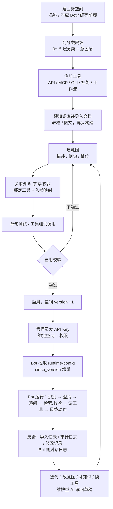

# 意图管理平台 · 全局需求文档（v0.17）

> 版本：v0.17（2026-11-13）。本文是**当前规格**：以代码现状为准，历次调整已并入正文，变更摘要见文末「版本记录」。
> 配套文档：`使用方接入指南.md`（Bot / 业务系统如何初始化、识别和调用）、`运营方配置手册.md`（控制台配置意图 / 知识 / 工具与 API Key）、`AI使用说明.md`（上述两份的索引，保留文件名以便旧链接可用）、`openapi.yaml`（OpenAPI 3.0.3，0.17.0）、`AI接入说明.md`（接口规则速查与 MCP 工具定义）。

---

## 1. 项目背景

- 各业务线都在做 Bot / 智能体（如 1688 店铺智能客服、跨境电商的生图生视频智能体）。每个 Bot 都要维护三样东西：**意图**（用户想办什么事）、**知识**（回答和校验依据）、**工具**（查库存、改价、查物流、生成图片等外部能力）。
- 过去这三样分散在表格、脑图、代码和各家平台里：
  - 意图口径和工具调用规则写在 Excel（如《意图 × 工具调用映射维护表》），改了以后 Bot 不知道；
  - 工具来自不同系统（HTTP 接口、MCP 服务、命令行 CLI、技能包、Dify / Coze 工作流），接入方式各不相同；
  - 运营用自己的 AI 工具整理意图，结果没有地方沉淀，也没有统一校验。
- 因此需要一个**通用的意图与知识管理平台**：把意图、知识、工具放在一处管理，按业务空间服务多个 Bot，并让 AI 能通过接口持续读写。

## 2. 目标与非目标

### 2.1 目标

| # | 目标 | 衡量方式 |
|---|---|---|
| 1 | 一个平台服务多个 Bot / 智能体：意图、分类、槽位按**业务空间**隔离；知识库和工具全平台通用 | 每个 Bot 只拉到自己空间的运行时配置 |
| 2 | 意图配置标准化：编码、分类路径、描述、例句、槽位、关联知识（参考 / 校验）、绑定工具（含入参映射），启用前强制校验 | 启用的意图 100% 通过必填校验 |
| 3 | 工具统一登记：API 接口 / MCP / CLI 命令 / 技能 / 工作流 五种类型用一个「注册工具」入口；平台自身接口作为「平台内置」工具 | Bot 从运行时配置即可知道每个工具怎么调 |
| 4 | 知识内嵌：表格 / 图文知识库在平台内导入、构建、检索，意图按「知识库 → 文档 → 切片」引用 | 校验类知识随运行时配置全文下发 |
| 5 | AI 可读写：运营的 AI 工具和 Bot 通过 REST / MCP + API Key 读写平台数据；写入一律为草稿，由人启用 | AI 写入有导入记录、幂等、限流 |
| 6 | 数据真实：只登记真实存在的工具和来自业务文档的知识，缺口明确标出，不用示例数据冒充 | 1688 空间工具绑定全部为真实 xclaw-cli 命令 |

### 2.2 非目标（当前版本不做）

| 不做 | 说明 |
|---|---|
| 线上对话执行 | 识别模型、会话状态、工具执行、生成后校验都在各 Bot / 智能体侧；平台只下发配置（工具中心「测试调用」仅供管理员自查，不是线上链路） |
| 评测与看板 | 不接 Langfuse 等评测平台，不做解决率 / 转人工率统计 |
| 版本发布 | 不做快照、Diff、灰度、回滚；只有空间 version 递增和修改记录 |
| 候选意图发现 | 不做语料聚类和新意图推荐 |
| 业务规则引擎 | 「议价超 3 轮转人工」这类规则不在平台执行，见第 10 节 V2 候选 |
| 空间级知识 / 工具权限 | 知识库和工具全平台可见；空间删除 / 归档、跨空间复制意图暂不做 |

## 3. 用户角色与用户场景

### 3.1 角色

| 角色 | 是谁 | 在平台上做什么 | 账号权限 |
|---|---|---|---|
| 业务运营 / 配置人员 | 客服运营、智能体产品 | 维护意图、分类、槽位、空间设置；维护和导入知识；给意图关联知识、绑定工具；单句测试；启用 / 停用 | editor |
| 技术接入 | 后端、平台工程师 | 在工具中心注册工具（API / MCP / CLI / 技能 / 工作流）、同步 MCP、上传技能包、同步工作流入参；发 API Key；部署平台 | admin（发 Key、建空间、真实测试调用、用户与审计） |
| 只读查看 | 业务方、评审 | 浏览意图、知识、工具，单句测试，请求预览 | viewer |
| AI Bot / 智能体 | 线上客服 Bot、跨境智能体 | 用 API Key 拉取本空间运行时配置，按配置识别意图、追问槽位、检索 / 校验知识、调用工具 | API Key（意图:读、知识:读、工具:读） |
| 运营的 AI 工具（维护型 AI） | Claude、Cursor、自建 Agent | 读分类和槽位，整理意图并写回草稿，导入知识 | API Key（加 意图:写、知识:写） |

控制台账号分 admin / editor / viewer 三种角色；API Key 的权限按 scope（意图:读 / 意图:写 / 知识:读 / 知识:写 / 工具:读）和绑定空间控制，与控制台角色无关。

### 3.2 场景

| 场景 | Bot / 智能体 | 典型意图 | 平台提供 |
|---|---|---|---|
| 电商店铺智能客服（当前：1688 智能客服，空间 `cs`） | 客服 Bot | 库存查询、询价报价、比价、明确采购、交期、定制、样品、发票、资质、售中改价改单、售中履约、售后处理 | 按「阶段 → 意图」组织的 17 个意图；回复规则 / 工具规则 / 置信度规则 / 收束话术 / 台账对照 5 个知识库；绑定真实 1688 开放平台命令（经西之月 xclaw-cli）；最终动作转人工 |
| 跨境智能体（当前：Moonclaw，空间 `mc`，演示数据） | 跨境智能体 | 产品主图、卖点图、A+ 详情、POD 图案、样机、生视频 | 「大类 → 问题桶 → 意图」三层；平台规范类知识（参考 / 校验）；技能、工作流、CLI 工具 |
| 维护型 AI 批量整理 | 运营的 AI 工具 | — | 读分类 / 槽位 / 已有意图 → 查重 → `batchUpsert` 写回草稿 → 运营审核启用 |
| 新业务接入（多业务通用） | 任意新 Bot | 由该业务自己定义 | 新建空间（名称、对应 Bot、编码前缀）→ 按该业务配置分类层级（0～5 层分类 + 意图，层名与层数按空间而定，不必套用「阶段」或「大类 / 问题桶」）→ 复用全平台已登记的知识库与工具，再为本空间建意图并绑定 |

分类层级是**按空间动态配置**的：不要假设所有空间都是两层或三层。1688 智能客服当前是「阶段 → 意图」，Moonclaw 是「大类 → 问题桶 → 意图」，新建空间默认后者，运营可在空间设置里改层数和层名（插入 / 删除先预览再确认）。

## 4. 用户使用流程



| 步骤 | 谁 | 在哪 | 产出 / 规则 |
|---|---|---|---|
| 1 建空间 | admin | 顶栏「新建空间」 | 名称*、描述、对应 Bot*、编码前缀*（1～4 位大写字母，全局唯一）；默认三层「大类 → 问题桶 → 意图」，带「通用（GEN）/ 默认」，version=1 |
| 2 配分类层级 | 运营 | 意图管理 › 空间设置 › 分类层级（或「新建意图」弹窗里的「管理分类」） | 改层级名称、插入 / 删除层级（先预览影响）、维护分类树 |
| 3 注册工具 | 技术 | 工具中心 › 注册工具 | 五种类型共用一个表单；MCP 同步子工具；技能上传包；工作流同步入参；大批 CLI 命令可用脚本按官方目录登记（如西之月） |
| 4 建知识库 | 运营 | 知识库 › 新建 / 导入文档 | 表格库表头一致、每行一个切片；图文库按正文切片；带平台 / 站点 / 语言 / 类目标签 |
| 5 建意图 | 运营 / 维护型 AI | 意图管理 › 新建意图 / 导入意图 / `batchUpsert` | 新意图一律草稿 |
| 6 关联与绑定 | 运营 | 意图编辑抽屉 | 知识按切片或整篇关联并选用途；工具两级选择并配置入参映射 |
| 7 测试 | 运营 / admin | 单句测试；工具中心「测试调用」 | 单句测试用本空间阈值给出命中 / 澄清 / 最终动作；测试调用默认只预览请求，管理员可真实执行（写操作需勾确认，记审计） |
| 8 启用 | 运营 | 清单或编辑抽屉 | 必填校验通过才保存；空间 version +1 |
| 9 发 Key | admin | 工具中心 › 接入与密钥 | 绑定空间 + scope；完整 Key 只显示一次 |
| 10 Bot 接入 | Bot | `GET /api/v1/runtime-config` | 按 version 增量拉取；按配置执行（见 `使用方接入指南.md`） |
| 11 反馈 | 平台 / Bot | 导入记录、审计日志（用户与审计）、意图修改记录 | 平台记录配置侧变更；对话日志在 Bot 侧 |
| 12 迭代 | 运营 / 维护型 AI | 同 5～8 | 改已启用意图会让 version +1；AI 不能启用、不能改已启用意图 |

## 5. 信息架构

```
顶栏：业务空间切换（只作用于意图管理）+「新建空间」（admin）+ 账号；admin 另有「用户与审计」入口
意图管理平台
├─ 意图管理    页签：意图列表 | 槽位 | 空间设置（识别与兜底 + 分类层级）| 导入记录；工具栏「新建意图」「导入意图」；意图编辑抽屉
├─ 知识库      知识库列表（全平台通用）→ 知识库详情（导入文档 | 知识库详情 | 知识库检索）
├─ 工具中心    页签：工具目录（外部 5 种类型 + 平台内置；按来源 / 类型 / CLI 命令包筛选、搜索、分页；注册 / 编辑 / 同步 / 测试调用）| 接入与密钥（API Key、REST 清单、导出运行时配置、给 AI 的说明文件、MCP 配置）
└─ 用户与审计  （仅 admin）用户与角色管理、审计日志
```

## 6. 模块规格

### 6.1 业务空间

- **切换**：顶栏「业务空间」下拉，只在意图管理页显示并生效；知识库页提示「知识库全平台通用」；工具中心不显示空间。
- **按空间隔离**：分类层级与分类树、意图、槽位、空间设置、意图导入记录、运行时配置及其 version。
- **全平台通用**：知识库、工具（含平台内置工具）。任何空间的意图都能关联任意知识库和工具；切片「关联意图」和工具「被意图使用」显示所有空间的意图并带空间名。知识的适用范围用标签（平台 / 站点 / 语言 / 类目）区分。
- **API Key**：可绑定一个或多个空间，绑定空间只约束意图类接口（意图、槽位、分类、空间设置、运行时配置）；知识与工具类接口对所有 Key 全局可用（仍受 scope 控制）。
- **新建空间**（admin）：名称*、描述、对应 Bot / 智能体*、编码前缀*（1～4 位大写字母，全平台唯一）。新空间默认「大类 → 问题桶 → 意图」三层，带大类「通用（GEN）」/ 问题桶「默认」，槽位为空，最终动作为「交给通用助手」，version 从 1 开始。
- **意图编码**：第一层分类有编码时为 `{前缀}.{第一层编码}.{意图}`，没有编码（或空间没有分类层）时为 `{前缀}.{意图}`；全大写，段内为大写字母 / 数字 / 下划线，最多 7 段；全局唯一，创建后不可改；意图只能在同一个有编码的第一层分类内移动。例：1688 智能客服前缀 `B`，`B.PRE.STOCK`；Moonclaw 前缀 `M`，`M.DESIGN.MAIN`。
- **通用表述**：界面统一用「用户」，不出现「买家 / 客服」专属表述；具体业务话术写在意图和知识里。

### 6.2 意图管理

**页面**
- 层级说明：页面描述按本空间层级名称写明，例如「大类 → 问题桶 → 意图」。
- 左侧：「全部」+ 当前空间**第一层**分类（显示意图数，含其下所有层），点击筛选右侧清单。没有分类层（0 层）时不显示左侧。
- 右侧清单：搜索（编码/名称/例句）、状态筛选；列：编码、意图（名称+意图描述摘要）、**每一层分类各一列（列名=层级名称）**、例句数、关联知识数、关联工具、状态、操作（编辑、启用/停用）。
- 「新建意图」：选最末一层分类（下拉显示完整路径，如「库存与货期 / 现货」）、填编码和名称，生成草稿后直接进入编辑。分类标签旁有「管理分类」链接，跳到「空间设置 › 分类层级」。
- 「导入意图」：清单工具栏按钮，打开导入弹窗（见下文「导入意图」）；顶部小页签「意图列表 | 槽位 | 空间设置 | 导入记录」切换。
- 清单上直接点「启用」也会走必填校验；不通过则打开编辑抽屉并列出缺项。

**意图编辑（抽屉，5 个区块）**：抽屉标题「编辑意图 · 编码」，顶部显示归属路径，每段带层级名称（如「大类 库存与货期 / 问题桶 现货 / 意图 现货确认」）。

| 区块 | 字段 | 规则 |
|---|---|---|
| ① 基本信息 | 意图名称*、编码*（创建后不可改）、所属分类（最末一层，下拉显示完整路径；第一层有编码时只能在该分类内移动）、意图描述*、例句*（每行一条） | 编码规则见 6.1，全局唯一；意图描述 ≥ 15 个字，写作要求见下 |
| ② 槽位 | 从**本空间槽位**下拉选择（显示名 + 英文名）、必填/选填、缺信息时追问（留空＝继承槽位默认话术，输入框以灰字显示继承值）；行尾「＋ 新建槽位」弹窗快捷创建，创建后自动进入本空间槽位列表并在本意图中选中 | 槽位必须在本空间且不重复；必填槽位须有生效追问话术（本意图覆盖值或槽位默认值） |
| ③ 关联知识 | 按「知识库 → 文档 → 切片」选择（可选整篇文档），列出全部知识库（全平台通用），可按平台/站点/语言/类目标签筛选；每条关联选择用途：**参考** / **校验** | 参考：检索后用于回答或生成；校验：生成后比对，是硬约束。切片被删除或覆盖后关联失效，会提示并移除 |
| ④ 关联工具 | **两级选择**：先选类型（API 接口 / MCP / CLI 命令 / 技能 / 工作流 / 平台内置，带可选数量，没有可选工具的类型不显示），再选工具；某类型超过 5 个时出现筛选框；上次选的类型在本次会话内记住。**CLI 命令**数量大（西之月 7037 条），第二级先选「命令包 › 业务分组」再搜索命令。维护类内置工具不可选。**MCP 要下钻**：第二级列的是 MCP 服务，点「关联」弹出该服务的子工具列表（可搜索、多选，只列已启用且远端仍存在的），不能整体关联服务。已关联的工具以卡片显示：类型标签、「写操作需确认」；**技能**卡片说明「本意图抽取的槽位会作为上下文交给 AI，无需入参映射，输出格式在回复要求中约定」并列出技能文件；**工作流**卡片的映射表多一列「默认值」。其余类型按入参逐项配置取值来源：槽位 / 常量 / 上下文（session_id、buyer_id、order_id、sku）；**文件 / 文件列表**入参只能选「文件 / 图片」类型的槽位 | 必填入参必须有映射（工作流：有默认值的可不映射）；映射的槽位必须存在；文件入参只能映射到文件 / 图片槽位；技能须已上传技能包 |
| ⑤ 单句测试 | 输入一句用户的话 | 见下文 |
| 修改记录 | 时间、操作人、改了什么（名称/意图描述/例句/槽位/关联知识/关联工具/状态） | 自动生成 |

**意图描述写作要求**：输入框下方灰色提示「这段描述会被大模型分类和语义匹配使用。请写清：用户想做什么；什么情况算这个意图；什么情况不算（容易和哪个意图混淆）。」并附示例：「用户想为商品生成符合平台规范的主图；"做主图""首图"算；只要换白底不算（→ 白底图）。」保存时少于 15 个字会提示；状态为启用时不通过则不保存。

**启用前必填校验**（状态从草稿/停用改为启用时触发，不通过不保存）：
1. 名称不为空、编码格式正确；意图描述不为空且不少于 15 个字；
2. 例句 ≥ 3 条；
3. 槽位都来自本空间槽位列表且不重复，必填槽位都有生效追问话术；
4. 至少关联 1 条知识或 1 个工具；
5. 关联的知识都存在；关联的工具都已注册、不是维护类内置工具，MCP 子工具已启用且最近一次同步时远端仍存在，必填入参都已映射、映射的入参确实存在、映射的槽位存在；
6. 意图挂在最末一层分类下。

**单句测试**：在「当前空间已启用意图 + 当前编辑中的意图」范围内做识别，**使用本空间设置的识别阈值**（结果顶部显示「使用本空间识别阈值 X（候选下限 Y）」），给出三种判定之一：
- **命中**：Top1 置信度 ≥ 阈值。继续显示槽位抽取结果、**参考知识**（切片内容）、**将执行的校验**、将调用的工具（类型 + 入参取值，并注明「失败重试 N 次，仍失败 → 最终动作」）、处理结论（缺必填槽位 → 追问话术，注明每槽位最多追问次数；否则调用工具 / 按参考知识回答 → 生成后执行 N 项校验）。
- **澄清（列候选）**：Top1 < 阈值，且有不低于候选下限的候选：显示澄清话术和最多 3 个候选（名称、编码、置信度），并注明「澄清 N 次仍不明确 → 最终动作」。
- **最终动作**：没有不低于候选下限的候选，直接显示本空间最终动作（告知无法处理时显示回复话术）。

平台用例句的二元组相似度模拟识别（结果带 `simulated: true`，分值与 Bot 的真实模型不同），只用于运营自查例句和配置，不作为效果评测。

#### 空间设置（页签「空间设置」）

每个空间一份，对本空间所有意图生效，替代原来逐个意图配置的兜底条件。保存时有改动则本空间 version +1，无改动提示「没有改动」不升版本；「恢复默认」只回填表单，点保存才生效。

| 设置 | 规则 | 默认 |
|---|---|---|
| ① 识别阈值 | 0～1，步长 0.05。提示「数值含义由 Bot 的识别模型决定，建议用单句测试和实际对话校准」 | 0.6 |
| ② 未识别处理 | Top1 < 阈值：列出不低于**候选下限（= 阈值 ÷ 2，只读，随阈值实时显示）**的最多 3 个候选让用户选；没有候选 → 最终动作。澄清话术可配置（必填） | 「我想确认一下，您是想要以下哪一项？」 |
| ③ 澄清最多次数 | 0～5 的整数，超过 → 最终动作 | 2 |
| ④ 槽位追问最多次数 | 每个必填槽位，0～5 的整数，超过 → 最终动作 | 2 |
| ⑤ 最终动作 | 转人工 / 交给通用助手 / 告知无法处理（选它时出现「回复」话术输入框，必填） | 1688 智能客服：转人工；Moonclaw 及新建空间：交给通用助手 |
| ⑥ 工具调用失败重试 | 0～3 的整数，仍失败 → 最终动作 | 1 |

页面下方展示 Bot 运行流程：识别 → 阈值判定 → 澄清 → 槽位追问 → 知识校验 → 调用工具 → 失败重试 → 最终动作。接口：`GET /api/v1/recognition`（读）、`PUT /api/v1/recognition`（写，维护类，version +1）；运行时配置顶层输出 `recognition`。

#### 分类层级（空间设置内）

每个空间自己定分类有几层、每层叫什么。最后一层固定是「意图」，上面可以有 0～5 层分类（新建空间默认「大类 → 问题桶 → 意图」；1688 智能客服当前为「阶段 → 意图」）。

| 操作 | 规则 |
|---|---|
| 改层级名称 | 直接保存，不影响数据；version +1 |
| 在某层之上插入一层 | 在每个受影响的父节点下新建一个「未分类」节点，原来的子节点挂到它下面；意图不动 |
| 删除某层 | 该层节点的子节点并到上一层；同一父节点下出现同名节点时自动合并；删除第一层时第一层编码随之丢弃（已有意图编码不变） |
| 预览 | 插入 / 删除前必须先预览：显示层级变化、分类数量变化、新建的「未分类」数、合并的节点、丢弃的编码、受影响意图数（其中启用的）和示例；确认后才执行 |
| 记录 | 每次调整 version +1，写审计日志「taxonomy.levels」，并在受影响意图的修改记录里写「分类层级调整：A → B」 |

分类树在同一页面维护：新增下级、改名、删除（有下级或有意图时不能删）；只有第一层可以设编码，第一层有意图时编码不可改。

#### 导入意图

入口：意图清单工具栏「导入意图」按钮，打开导入弹窗。流程三步：① 上传 → ② 解析预览 → ③ 完成。弹窗内提供示例文件（AI 工具产出 JSON、Excel 模板、Markdown）和「下载模板」（意图导入模板 .csv / .json / .md）。

**支持格式**

| 格式 | 说明 |
|---|---|
| JSON（推荐，AI 工具产出） | `{"intents":[{code,name,category_path[],description,examples[],slots[{name,required,ask}]}]}` 或直接数组；`category_path` 从第一层写到最末层，每段写编码或名称（旧格式 l1/l2 仍可用） |
| Excel / CSV | 表头：编码, 名称, 分类路径, 意图描述, 例句, 槽位；分类路径用「/」分隔任意层数，例句用「｜」分隔，槽位用「；」分隔（旧表头 L1, L2 仍可用） |
| Markdown | 每个意图一个小节：`## 编码 名称`，下面 `- 归属：第一层 / 第二层 / …`、`- 意图描述：`、`- 例句：a｜b`、`- 槽位：order_id(必填:追问话术)；sku` |

导入到**当前空间**；弹窗内示例文件随空间变化（Moonclaw 空间为 Moonclaw 示例）。

**解析预览的判定**

| 判定 | 条件 | 默认处理 | 可选 |
|---|---|---|---|
| 新增 | 编码不存在 | 导入（状态为草稿） | 跳过 |
| 更新 | 编码已存在且内容有差异（列出差异：名称/意图描述/新例句数） | 合并 | 覆盖、跳过 |
| 重复 | 编码已存在且内容无新增 | 跳过 | 覆盖 |
| 冲突 | 编码格式无效、编码已被其他空间使用、缺名称、文件内编码重复、与同空间其他意图同名 | 跳过 | — |

- 分类路径不存在、层数不对或没到最末一层时（`UNKNOWN_CATEGORY`），预览里给出可选的最末层分类下拉，选定后即可导入。
- **槽位**：槽位名在本空间已存在就直接使用；不存在则入库时自动在本空间新建为「文本」槽位（显示名同英文名，默认追问「请补充{名称}」），预览「说明」列提示「本空间没有的槽位将自动新建为文本槽位：…」。同义名归一放到 V2。
- **兜底字段一律忽略**：文件里带 `fallback`（JSON）、「兜底条件 / 转人工条件」列（CSV）、`- 兜底：/ - 转人工：`（Markdown）或旧格式 `human` 时不报错，该行「说明」列提示「兜底已改为空间级设置，已忽略」，入库时不写入。
- 合并：只补充新例句、新槽位，非空字段不覆盖；覆盖：替换名称、意图描述、例句、槽位，已关联的知识和工具保留。
- 已启用的意图被更新后若不再满足必填校验，自动转为草稿并写修改记录。
- 新导入的意图一律为**草稿**，关联知识/工具并通过校验后由运营启用。

#### 槽位（页签「槽位」）

每个业务空间维护自己的槽位列表，其他空间不可见；同一个英文名在不同空间是两份独立的槽位。

| 字段 | 规则 |
|---|---|
| 名称* | 英文名（小写英文/数字/下划线，本空间唯一，创建后不可改）+ 显示名 |
| 类型 | 文本 / 数字 / 日期 / 枚举 / 文件 / 图片（文件 / 图片的值为文件链接，工具的文件入参只能映射到这两类） |
| 可选值 | 仅枚举类型显示且必填，逗号分隔 |
| 默认追问话术* | 意图未覆盖时使用 |

- 列表列：名称（显示名 + 英文名）、类型、可选值、默认追问话术、被哪些意图使用（本空间意图编码，可点击打开编辑；超过 6 个显示「共 N 个」弹窗）、操作（编辑、删除）。
- 新建：页签内「＋ 新建槽位」，或意图编辑槽位区的「＋ 新建槽位」快捷创建。
- 编辑：可改显示名、类型、可选值、默认追问话术；继承默认话术的意图随之生效（MVP 不触发 version 变化）。
- **删除**：被意图使用时直接禁止删除，弹窗显示被哪些意图引用（编码、名称、状态），需先在意图中移除；未被使用时确认后删除。不做联动下架。
- 当前数据：1688 智能客服 17 个槽位（见第 7.1 节）；Moonclaw 为演示槽位。

#### 导入记录

意图管理页顶部小页签「意图清单 | 导入记录」，只显示当前空间的记录。每次通过文件导入或通过开放接口（API / MCP）写入意图都记一条。字段：编号、文件 / 调用、来源（文件上传 / AI 工具产出 / AI 工具（API））、时间、操作人（API 调用记为 Key 名称）、结果（新增 / 更新 / 跳过数量）。

### 6.3 知识库（内嵌，对齐原系统「AI知识库」）

标注说明：**【原有】** 为原系统已有能力，平台内嵌时字段、文案、布局保持一致；**【新增】** 为本平台补充的需求。

#### 6.3.1 列表页【原有】

- 顶部：标题「AI知识库」，说明「AI知识库是检索增强生成（RAG）服务，支持全模态数据：富文本、表格、图片…」；右侧「设置」（检索返回切片数 TopK、相似度阈值）。
- 搜索区：「知识库名称」输入框，按钮「查询」「重置」「另存为快捷查询」（保存后以快捷查询标签展示，点击即查询）；下方「+新建」。
- 表格列：

| 列 | 说明 |
|---|---|
| 序号 | — |
| 知识名称 | 名称后以小标签显示知识库的平台/站点/语言/类目标签【新增，不加列】 |
| 知识库类型 | 「表格知识库」或「图文知识库-富文本」 |
| 状态 | 圆点 + 文字：构建成功（绿）/ 构建中 / 构建失败 |
| 最新更新时间 | 可排序 |
| 创建时间 | 可排序 |
| 操作 | 查看、编辑、删除（蓝色文字链接）；编辑改名称和标签【新增】；删除被意图关联的库时提示影响的意图【新增】 |

- 列表显示全部知识库（全平台通用，不随空间切换）【新增】。

#### 6.3.2 新建弹窗【原有】

- 标题随所选类型变化：「创建表格知识库」/「创建图文知识库」。
- 字段：

| 字段 | 内容 |
|---|---|
| * 知识库名称 | 输入框，名称不可重复 |
| * 导入知识库 | 两张卡片二选一：**表格知识库**——列表格式的数据，比如问答对、用户数据等结构清晰、规范化的文档，支持 .xlsx .xls .csv .json .jsonl；**图文知识库**——支持图文文档内容数据，如图片、文档等，内容丰富、版面复杂的内容，支持 .docx .doc .pdf .pptx .ppt .html .htm .md .png .jpg .jpeg .webp |
| * 导入文件 | 「上传文件」按钮；下方提示：「支持扩展名：…，请保证表头完全一致！」「请上传文件，若文件过大，导入可能花费5～30分钟不等，请耐心等待。」「若导入新的文件，系统将校验上传的文档内容和名称，若与已有的文档相同，则覆盖并更新原文档。」 |

- 【新增】适用范围标签（平台 / 站点 / 语言 / 类目，逗号分隔）。知识库全平台通用，不选空间。
- 底部按钮：「取消」「确定，并导入」。导入后状态先为「构建中」，构建完成变为「构建成功」（失败为「构建失败」）。

#### 6.3.3 详情页【原有】

以顶部标签页打开，标签标题「知识库详情」（可关闭，返回「AI知识库」标签）。

- 头部：图标、知识库名称、绿色状态徽标、「更新时间：」「知识库类型：」，以及「标签：」【新增】。
- 三个页签：

| 页签 | 内容 |
|---|---|
| 导入文档 | 蓝色「导入文档」按钮（同新建弹窗的导入逻辑），右侧「请输入文档名称」搜索框。表格列：序号、文档名称、构建状态（绿色徽标）、数据量（表格库为条数，图文库为字符数）、上传时间、更新时间、操作（切片详情、删除） |
| 知识库详情 | 顶部文档下拉（全部文档 / 单个文档）。表格列：序号、所属文档、知识切片、**关联意图【新增】**、更新时间、操作（查看） |
| 知识库检索 | 输入问题，返回命中切片、所属文档和相似度（按 TopK 和阈值过滤）；【新增】平台 / 站点 / 语言 / 类目四个标签筛选下拉，结果多一列「标签」 |

#### 6.3.4 新增需求

| 新增 | 说明 |
|---|---|
| 关联意图 | 切片列表多一列「关联意图」，显示引用该切片的意图编码，点击打开意图编辑 |
| 切片编辑 | 切片「查看」弹窗内可直接编辑（表格库按表头逐列编辑，图文库编辑正文），保存后更新时间刷新，并在关联意图的修改记录中留痕 |
| 覆盖影响提示 | 同名或同内容覆盖导入时，若原文档中被意图关联的切片在新文件中不存在，列出受影响的意图（编码、名称、状态、文档、切片序号），须勾选「我已知晓影响，确认覆盖」才能导入；导入后移除失效关联，已启用意图若因此校验不通过自动转为草稿并记录 |
| 对外写入接口 | 运营的 AI 工具可通过平台内置工具（API / MCP）导入文档、编辑切片、检索知识，不需要 X-Space-Id（见第 9 节） |
| 不区分空间 | 知识库全平台通用，列表始终显示全部，切换空间不影响；任何空间的意图都可关联；切片「关联意图」列显示所有空间的意图（带空间名） |
| 适用范围标签 | 知识库和切片都可设置 platform / site / language / category 标签（多值）；切片未设置的类别继承知识库标签；标签为空表示不限。切片「查看」弹窗可编辑切片标签（留空＝继承）；检索、意图知识选择器、内置工具「检索知识」都可按标签过滤 |

当前知识库清单见第 7 节（1688 客服 5 个规则库来自业务文档；Moonclaw 7 个库为演示数据，切片以「【示例，非真实平台规定】」开头）。

#### 6.3.5 导入规则（同一套逻辑，用于新建弹窗和详情页「导入文档」，知识只能从这两处导入）

1. 扩展名必须属于所选类型的支持列表。
2. 表格知识库：同一知识库内所有文件表头必须完全一致（列名与顺序），首个文件确定表头；不一致直接拒绝并展示两边表头。每行数据构建为一个切片。
3. 图文知识库：服务端提取正文并切分为切片；图片（png / jpg / webp）暂不做 OCR，导入后显示「构建失败」并给出原因。
4. 与已有文档**名称或内容相同**即覆盖并更新原文档：表格库按首列匹配、图文库按切片内容匹配，匹配上的切片保留 ID 和意图关联。
5. 导入异步构建，文档列表显示构建状态、上传时间和更新时间。

### 6.4 工具中心

平台**登记**工具（怎么调、要什么参数、是否写操作），线上执行在各 Bot / 智能体（执行规则见 6.5 与 `使用方接入指南.md`）；平台自己只在「测试调用」时由管理员真实执行一次。

工具中心两个页签：**工具目录** | **接入与密钥**。页面不显示标题和说明段落，保持简洁。

- **列表**（显示全部工具，切换空间不影响）：右上角只有一个「＋ 注册工具」按钮；两组筛选带数量——「按来源」（全部 / 外部 / 平台内置）、「按类型」（全部 / API 接口 / MCP / CLI 命令 / 技能 / 工作流；MCP 的数量是服务数）；CLI 另可按「命令包」筛选；支持搜索和分页（工具多时按名分批读取并缓存）。表格使用**固定列宽**，长工具名截断显示、不把表格撑出卡片（在 1280 宽度下仍保持表内排布）。列：显示名+工具名、类型标签（写操作需确认的另加标签）、来源（外部 / 平台内置 + 「维护类」或「可在意图中使用」；MCP 服务为示例数据时标「示例数据」）、描述、接入信息（API：方法+地址；MCP 服务：传输方式+凭据（位置 名称 ← $环境变量）+地址/命令+最近同步；MCP 子工具：tools/call 工具名；CLI：命令模板+鉴权+输出格式；技能：技能包版本+文件数；工作流：平台+基址/区域+工作流 ID+同步/流式；平台内置：合并的 REST 路径 + 对应 MCP 工具 + 是否需要 X-Space-Id）、入参（* 为必填；技能显示「无（槽位作上下文）」）、被哪些意图使用（所有空间，带空间名）、操作（测试调用；外部工具可编辑 / 删除，MCP 服务可同步 / 编辑 / 删除；平台内置显示「平台提供，不可编辑 / 删除」）。
- **注册/编辑**（选择类型后只显示该类型的字段，界面保持简单）：

| 字段 | 规则 |
|---|---|
| 工具类型* | API 接口 / MCP / CLI 命令 / 技能 / 工作流，切换后表单随之变化；编辑时不可改类型。「平台内置」只是来源筛选，不是可注册的类型 |
| 工具名* | 小写英文/数字/下划线，唯一，注册后不可改 |
| 显示名*、描述* | 描述写清用途，运营据此选择工具 |
| API 接口（HTTP） | 接口地址*（http(s)）、方法（GET/POST/PUT/DELETE）、鉴权方式（无 / API Key / Bearer Token / OAuth2，密钥由平台加密托管）、入参、出参示例（合法 JSON） |
| CLI 命令 | 可执行程序*（如 `xclaw-cli`）、已验证版本、命令包 / 业务分组（可选，用于筛选）、命令/子命令模板*（以可执行程序开头，用 `{参数名}` 引用入参；选填参数为空时连同前面的 `--选项` 一起省略）、入参、鉴权方式（无 / CLI 内置登录（OAuth）/ 环境变量 Token）、凭据环境变量名（大写英文 / 数字 / 下划线，如 `XCLAW_UMC_TOKEN`；平台只存变量名，不存值）、登录/鉴权命令（如 `xclaw-cli auth login`）、安装方式（所需环境）、输出格式（JSON / 纯文本）、「写操作，Bot 执行前需用户确认」、输出说明/示例。校验：模板引用的 `{参数}` 必须已定义，每个入参都必须出现在模板中 |
| MCP | 见下文「MCP 服务」，在同一个抽屉里登记服务；保存后抽屉内直接出现「同步工具」面板 |
| 技能 | **上传技能包***：选择文件夹（浏览器文件夹上传）或 .zip（服务端解压解析）。包内必须有 SKILL.md（取最浅的一个作为包根），其 YAML 前置元数据必须含 `name` 和 `description`；工具名按 name 预填（小写、`-` 换 `_`），**描述取自 description，只读**；忽略 `__MACOSX`、`.DS_Store`，拒绝 `../` 等越界路径，最多 500 个文件、总大小不超过上传上限。上传后先「暂存」（24 小时内有效），保存工具时才生效；**重新上传 = 新版本**（v1、v2…，历史版本可下载）。技能**没有入参**，不显示入参表和输出说明 |
| 工作流 | 平台*：**Dify** / **Coze** / **通用 HTTP**；响应模式（同步 blocking / 流式 streaming）；超时秒数（可选）；「写操作，Bot 执行前需用户确认」。**Dify**：API 基址*（默认 `https://api.dify.ai/v1`，请求 `POST {基址}/workflows/run`）、应用 API Key 环境变量名*（默认 `DIFY_APP_KEY`）、user 字段（常量值 / 映射会话用户）。**Coze**：区域*（api.coze.cn / api.coze.com）、工作流 ID*、访问令牌环境变量名*（默认 `COZE_PAT`）、workflow_version（可选）；同步走 `/v1/workflow/run`，流式走 `/v1/workflow/stream_run`；折叠的「高级」里有 is_async（异步运行）、bot_id、app_id、ext（JSON 对象）。**通用 HTTP**：请求地址*、方法（POST/GET/PUT）、鉴权（无 / API Key / Bearer Token）+ 环境变量名。**入参**（Dify / Coze）：点「同步入参」从平台读取——在线读取（临时输入一次密钥，**不保存、平台也不读服务器环境变量**；Dify 调 `GET {基址}/parameters`，Coze 调 `GET /v1/workflows/{id}?include_input_output=true`）或粘贴上述接口返回的 JSON；同步结果默认只读，可点「微调」修改、「锁定」恢复只读，「刷新」重新同步；通用 HTTP 手工维护入参。**输出字段映射**（可选）：工作流输出字段 → 映射名（如 `data.outputs.result` → `result`），Coze 同步时按输出定义预填 |
| 入参 | 参数名、类型（string / number / boolean / 文件 file / 文件列表 file_list / string[]）、是否必填、说明，工作流另有默认值；参数名不可重复（API / CLI / 通用 HTTP 工作流手工填写；MCP 子工具由同步到的 inputSchema 生成；Dify / Coze 工作流由同步生成；技能无入参） |
| 负责人* | — |

- 意图里的工具入参映射（槽位 / 常量 / 上下文）对 API / MCP / CLI / 工作流一致；技能不做映射（槽位作为上下文交给 AI）。

#### MCP 服务

第三方 MCP 一般不是一个原子能力，而是一个服务里打包一批工具。工具中心按「**服务 → 子工具**」两级登记：

| 步骤 | 规则 |
|---|---|
| 注册 MCP 服务 | 服务名*（小写英文 / 数字 / 下划线，唯一）、显示名*、说明、传输方式*（Streamable HTTP / SSE（旧版）/ stdio）、服务地址*（HTTP / SSE）或 启动命令* + 参数 + 环境变量（stdio）、负责人*。**鉴权凭据**：可加多条，每条 = 位置（请求头 / URL 参数；stdio 为环境变量）+ 名称 + 环境变量名，可选填密钥（仅用于平台在线同步，加密保存、只写不读）。**通用预设**：Bearer Token（`Authorization: Bearer ${ENV}`，环境变量 `MCP_TOKEN`）、API Key 请求头（`X-API-Key` / `MCP_API_KEY`）、App ID + App Key（`X-App-Id` / `X-App-Key`，`MCP_APP_ID` / `MCP_APP_KEY`）、URL 参数（`api_key` / `MCP_API_KEY`）。服务地址里带密钥参数（如 `api_key`、`token`、`secret-key`）时，保存时自动从 URL 去掉、转为一条 URL 参数凭据（值加密保存）并提示 |
| 同步工具 | 「在线同步」：平台连接服务执行 initialize + tools/list（自动翻页）；「手动导入 JSON」：粘贴 tools/list 的返回（JSON-RPC 响应、`{"tools":[…]}` 或数组）。stdio 服务默认不在平台服务器上执行命令（需运维设置 `IP_MCP_STDIO_ENABLED=true` 且仅管理员可在线同步），一般用手动导入 |
| 差异预览 | 同步先预览、确认后生效：**新增**（绿）、**变更**（黄，列出新增 / 删除入参、必填变化、类型变化、说明变化、「远端重新出现」）、**消失**（红）、未变数量。消失的工具如果仍被意图使用：**保留并标红**，列出受影响意图，不会静默删除；没人用的直接从目录删除 |
| 确认同步后 | 用到已消失工具或因变更不再通过校验的**已启用意图自动转草稿**并写修改记录；相关空间 version +1；写审计日志「mcp.sync」 |
| 子工具 | 名称为 `{服务名}.{远端工具名}`；可单独**启用 / 停用**、标记「**写操作需确认**」（同步时按 annotations 预填：readOnlyHint=false 或 destructiveHint=true 时默认勾选）；说明和入参来自同步，不能手工编辑或单独删除；停用后用到它的已启用意图转草稿 |
| 列表 | 每个 MCP 服务一行（工具数、启用数、远端已消失数、传输方式、地址、鉴权、最近同步），点开展开子工具行；被意图使用的服务不能删除 |

- 意图绑定 MCP 时必须下钻到子工具（见 6.2 ④），不能绑定整个服务。
- 运行时配置导出 `mcp_servers`（只含被已启用意图用到的服务）和用到的子工具（含 inputSchema）；**密钥不导出**，`credentials` 只给每条凭据的位置、名称和环境变量名，URL 不含密钥；旧字段 `auth`（第一条凭据摘要，含 `token_env`）保留兼容。
- 当前没有登记外部 MCP 服务（示例服务已清除）；表单与预设里不出现任何具体厂商。
- 平台内置的 `intent_platform` 服务由平台维护，不可编辑、不可同步。

#### 平台内置工具

平台自身的接口也是工具：可以在意图里自循环使用（如让 Bot 在回答前检索知识），也开放给其他 AI 调用。内置工具由平台提供，**不可编辑、不可删除**，类型为 API 或 MCP；22 个 REST 路径和 6 个 MCP 工具合并为 8 个能力，清单见 9.3。

- **维护类**（写入 / 修改意图、导入知识、槽位写入 / 删除）：在意图「关联工具」下拉中不出现，启用校验也会拦截；只给维护用 AI 通过 API Key 调用。
- **读取类**：可在任何空间的意图里关联，入参映射与外部工具相同；按空间的读取类工具在运行时使用调用方 Bot 所在空间。

- 编辑工具新增必填入参时，在使用该工具的意图上写修改记录提醒补映射（已启用意图下次保存会被校验拦住）。
- **测试调用**（五种类型都支持）：按入参填写测试值（未填的用默认值），校验必填。
  - **请求预览**（所有角色）：API 显示方法+地址+请求体；CLI 显示按模板拼好的完整命令行；工作流按平台显示真实请求形态（凭据以 `$环境变量` 占位）；MCP 显示连接信息和 JSON-RPC `tools/call`；技能显示版本与文件列表。
  - **真实执行**（仅 admin，每次写审计日志）：CLI 在平台后端机器上按参数数组执行（不经 shell，有超时和输出上限，凭据只取服务器环境变量或 CLI 自己的登录态，不回显）；HTTP 真实发请求，平台内置工具在进程内调用本平台接口（临时 Key，用完即删）；MCP 做 initialize + tools/call；工作流按 Dify / Coze / 通用 HTTP 真实调用；技能不执行，只返回 SKILL.md 与文件列表。
  - **写操作**（工具标「写操作需确认」或维护类内置工具）必须勾选确认（请求带 `confirm=true`），否则返回 `CONFIRM_REQUIRED`。
  - 服务器可用 `IP_TOOL_TEST_ENABLED` / `IP_TOOL_TEST_CLI_ENABLED` 关闭真实执行；CLI 未安装返回 `CLI_NOT_INSTALLED`，未登录时提示执行登录命令或设置凭据环境变量。

### 6.5 工具中心 › 接入与密钥与运行时配置

平台内置工具的调用方式，供运营的 AI 工具、维护用 AI 以及各 Bot / 智能体读写本平台。意图类接口（意图、槽位、分类、运行时配置）按空间处理：请求头 `X-Space-Id` 或 query 参数 `space`，必须是 Key 绑定的空间之一，否则 403；知识与工具类接口全局可用，不需要 X-Space-Id。页面顶部有「示例与运行时配置使用的空间」下拉（只影响本页示例、模拟调用和导出）。

- **API Key 管理**（仅 admin）：新建（名称 + 绑定空间（多选，至少 1 个）+ 权限：意图读/写、知识读/写、工具读），完整 Key 只在创建时显示一次；列表显示全部 Key，含绑定空间（意图 / 槽位）、归属、权限、创建时间、最近调用、状态；可吊销。绑定空间只约束意图类接口，知识与工具类权限对所有空间生效。
- **REST 接口清单**新增「空间」列：按空间的标「X-Space-Id」，知识库 / 工具 / 导入任务标「全局」；所有接口都已合并登记为工具目录里的平台内置工具。
- **REST 接口**、**MCP 服务**：见第 9 节。
- 意图写接口复用意图管理「导入意图」的校验与判定逻辑，并在「意图管理 › 导入记录」留下「AI 工具（API）」记录；知识写接口复用知识库导入规则（6.3.5）。
- **导出运行时配置（按空间）**：说明「供 {空间对应 Bot} 拉取本空间已启用意图的完整配置」；接口 `GET /api/v1/runtime-config`（带空间，`since_version` 增量，响应带 `version`）；「下载当前配置 JSON」按钮导出**当前空间**（文件名 `runtime-config_{空间}_v{版本}.json`）。内容：
  - `space`（id、name、bot）、`version`、`generated_at`；
  - `recognition`：本空间的空间设置 `{threshold, candidate_min, max_candidates, max_clarify, max_slot_ask, tool_retry, final_action(handoff_human / general_assistant / decline), final_action_label, clarify_prompt, final_message}`；
  - `slots`：本空间的槽位定义（名称、显示名、类型、可选值、默认追问）；
  - `intents`：只含已启用意图，每个带 code、name、category_path、description、examples、slots（required、生效 ask、是否覆盖）、knowledge（kb_id / doc_id / chunk_id，`usage`：reference / validate）、tools（工具、`type`：http / mcp / cli / skill / workflow、入参映射；mcp 另带 `server`、`mcp_tool`）；每个意图带 `category_path`（从第一层到最末层的 `{code, name}`）；
  - `taxonomy`：本空间层级定义 `levels`（每层 depth、name，最后一层是意图）与分类树 `categories`；
  - `mcp_servers`：已启用意图用到的 MCP 服务连接信息（transport、url 或 command/args/env、credentials）；**不含密钥**，`credentials[]` 给出每条凭据的位置、名称和 Bot 侧保存密钥的环境变量名（`auth` 保留兼容）；
  - `validation_sets`：所有「校验」知识的**完整切片内容**（含表格 cells 和标签、被哪些意图使用）；整篇文档关联时导出全部切片；
  - `tools`：本空间已启用意图**引用到的**工具（外部或平台内置，工具全局通用，不再按空间登记），含类型、`source`（external / builtin；内置工具另带 maintenance、space_scoped、endpoints、mcp_tools）及类型特有字段、入参 schema（http：method、url、auth；mcp：server、mcp_server（连接信息）、mcp_tool、input_schema、confirm_required，只导出被用到的子工具；cli：`cli{bin, command_template, auth, auth_env, login_command, install, verified_version, output_format, confirm_required, output_description, pack, pack_name, group, source_ref, risk_level}`；skill：`skill{name, version, description, files[], download_path}`（无 input_schema，技能包从 `GET /api/v1/tools/{name}/skill-package` 下载）；workflow：`workflow{platform, response_mode, auth_env, timeout_sec, output_mapping, confirm_required, 平台字段}` + input_schema（含 default）。
  - **Bot 执行规则**（平台只登记，执行在 Bot）：http 按 method+url 发请求（GET 放 query，其他放 JSON body），凭据由 Bot 侧托管；mcp 按 mcp_server 连接（同一服务一个会话）调 `tools/call`，confirm_required 时先向用户确认；cli 在 Bot 运行环境执行命令模板（未安装按 install 安装，凭据放在 auth_env 指定的环境变量或按 login_command 引导授权，选填空值省略对应 `--选项`，按参数数组执行不拼 shell，json 输出解析 stdout，confirm_required 时先向用户确认）；skill 下载技能包交给 AI，槽位作上下文、不做映射；workflow 按平台调用（Dify / Coze / 通用 HTTP），凭据取 auth_env，必填未映射用默认值，按 output_mapping 取结果。其他类型入参统一按 param_map（槽位/常量/上下文）取值。
  - 提示：「本空间的意图启用、停用或编辑后，version 会递增（各空间版本独立）；Bot 发现版本变化后应重新拉取，并清空意图识别缓存。」
- **version 维护**（每个空间独立）：修改空间设置，启用、停用意图，编辑已启用意图（含导入合并、知识删除/覆盖、工具变更导致已启用意图变化）、调整分类（新增 / 改名 / 删除分类、改层级）、MCP 同步或子工具启停影响已启用意图时，该空间 version +1。

### 6.6 用户与审计（仅 admin）

- 用户：用户名、显示名、角色（admin / editor / viewer）、启用 / 停用、重置密码；至少保留一个 admin（`LAST_ADMIN`）。
- 角色权限：viewer 只读（可单句测试、工具请求预览）；editor 可编辑意图、分类、槽位、空间设置、知识库、工具；admin 另可建空间、管理 API Key、管理用户、查看审计、对工具做真实测试调用。
- 审计日志：所有写操作（控制台用户与 API Key）都记录时间、操作人（类型 / 名称）、动作、对象、空间、摘要、request_id、IP；工具真实测试调用、MCP 同步（`mcp.sync`）、层级调整（`taxonomy.levels`）均在内。

## 7. 当前接入与数据（v0.17）

### 7.1 1688 智能客服（空间 `cs`，前缀 `B`）

数据来源：《意图 × 工具调用映射维护表》v1（xlsx 全部工作表），由脚本生成并入库，可重复执行：`python -m app.cs1688 backup --out <文件>` → `python -m app.cs1688 apply --yes --backup <文件>`；`status` 查看结果。源文件、生成脚本和数据在 `backend/seed/cs_1688/`。执行时不影响其他空间。

- **分类层级**：「阶段 → 意图」两层；阶段 4 个：售前 `PRE`、售中 `MID`、售后 `POST`、非询盘 `NONE`（映射表的 stage 列作为分类层）。原「大类 → 问题桶 → 意图」三层、58 个分类、123 个演示意图已删除（删除前已备份）。
- **意图**：17 个（对应映射表 17 个 intent_bucket），均已启用（映射表变更记录写的是「审批：待业务确认」，业务未确认前可改回草稿）：

| 阶段 | 意图（编码） | 绑定工具 |
|---|---|---|
| 售前 | 库存查询 `B.PRE.STOCK`、信息咨询 `B.PRE.INFO`、询价报价 `B.PRE.QUOTE`、明确采购 `B.PRE.BUY`、尺寸定制 `B.PRE.CUSTOM_SIZE`、logo/知识产权 `B.PRE.LOGO`、样品 `B.PRE.SAMPLE`、发票对公 `B.PRE.INVOICE`、资质合规 `B.PRE.CERT`、开场领券 `B.PRE.COUPON` | 获取商品 |
| 售前 | 比价中 `B.PRE.COMPARE` | 获取商品 + 修改订单价格（需确认） |
| 售前 | 交期 `B.PRE.LEADTIME` | 获取商品 + 物流跟踪 |
| 售中 | 售中改价改单 `B.MID.CHANGE_ORDER` | 修改订单价格（需确认）+ 获取商品 |
| 售中 | 售中履约 `B.MID.FULFILL` | 物流跟踪 + 获取商品 + 退款单查询 |
| 售后 | 售后处理 `B.POST.AFTERSALE` | 退款单查询 + 物流跟踪 + 获取商品 |
| 非询盘 | 无买家意图/空会话 `B.NONE.EMPTY`、其他 `B.NONE.OTHER` | 无（只澄清或转人工，靠知识规则） |

- 每个意图：描述（含「什么算 / 什么不算 → 易混意图」）、4 条例句、必填 / 选填槽位、关联知识 4～8 条（回复规则行与置信度规则整篇为「校验」，收束话术、工具规则、台账对照为「参考」）。
- **槽位**（17 个）：shop_id（会话所属店铺，由 Bot 带入，不向用户追问）、offer_id、sku_id、qty、order_id、target_price、custom_type、custom_spec、logo_req、logo_file（图片）、sample_qty、invoice_type、cert_type、question_type、aftersale_type（枚举：退款 / 退货 / 换货 / 补发）、carriage、entry_discounts（后两个是改价参数，单位为分，由客服按目标价换算填写，不向用户追问）。
- **映射表工具 → 平台工具**（只绑定真实存在的命令，映射表里的规划工具不登记成假工具）：

| 映射表 tool_id | 平台工具（xclaw-cli 命令） | 匹配度 | 说明 / 缺口 |
|---|---|---|---|
| get_stock_eta 查库存/交期 | `xclaw_platform_alibaba_product_get` 获取商品 | 中 | 有 SKU 可售数量；**缺**预计到货日、截单发货规则 |
| get_price_quote 报价 | 同上 | 中 | 有阶梯价；**缺**包邮门槛、活动价 |
| get_spec_media 规格/图/资质 | 同上 | 中（资质、发票为低） | 有属性和图片；**缺**资质证书、发票类型 |
| get_custom_moq 定制/起订 | 同上 | 低 | 只有起订量；**缺**打样费、打样周期（定制服务查询需要类目 ID，不绑定） |
| apply_change_price 改价 | `xclaw_platform_alibaba_trade_order_modifyorderprice_call` 修改订单价格 | 高 | 金额单位为分；平台强制「写操作需确认」 |
| ship_urge_track 催发/物流 | `xclaw_platform_alibaba_trade_getlogisticstraceinfo_sellerview_v1_call` 物流跟踪（卖家视角） | 高 | 按订单号返回运单与节点 |
| aftersale_refund 售后退款 | `xclaw_platform_alibaba_trade_refund_sellerview_query` 退款单查询（卖家视角） | 中 | 只能查询（query_type=1），不能发起退款；目录标为写操作需确认 |
| lock_or_hold_stock 锁仓 | — | **缺口** | 没有占库存接口（修改库存语义不同，不替代） |
| clarify_slot / handoff_human / reply_template | — | 不是工具 | 由槽位追问话术、空间最终动作（转人工）和知识里的回复规则承担 |

- **知识库**（5 个表格库，内容只来自映射表，不补充价格、库存、时效、政策等事实）：

| 知识库 | 切片 | 内容 |
|---|---|---|
| `kb_cs_reply` 1688客服-回复规则与禁止项 | 17 | 每个意图的必填槽位、主 / 辅工具、三档置信度动作、禁止项、备注、会话量与文字转单率 |
| `kb_cs_tools` 1688客服-工具使用规则 | 11 | 映射表工具字典 + 对应的平台工具与匹配说明 / 缺口 |
| `kb_cs_conf` 1688客服-置信度与并行规则 | 10 | R1～R6 与 4 条通用原则 |
| `kb_cs_close` 1688客服-高转化收束话术 | 16 | 每个意图的收束动作 |
| `kb_cs_ledger` 1688客服-台账意图对照 | 10 | 台账意图 → intent_bucket → 主工具 |

- **置信度规则（概要，原文在 `kb_cs_conf`，由 Bot 执行）**：R1 置信 ≥ 0.85 且槽位齐 → 主 + 辅工具可并行，给完整草稿；R2 0.60～0.85 或缺关键槽位 → 只问 1 个澄清问题，禁用成交类工具；R3 < 0.60 或投诉 / 超授权 → 转人工并说明理由；R4 工具失败 → 不得估计有货 / 价格，改为澄清或转人工；R5 售中有订单号 → 订单类工具结果进首句；R6 每轮最多主工具 + 2 个辅工具。平台空间设置的识别阈值为 0.6、最终动作为转人工，与 R3 一致。
- 已删除的演示数据：123 个意图、58 个分类、6 个不再使用的槽位、导入记录 IMP-1001 / IMP-1002，以及演示知识库 `kb_aq` 客服AQ、`kb_rule` 业务规则文档、`kb_test` 测试知识库、`kb_sales` 销售助手-帮助中心-常见问题（均已先备份）。

### 7.2 西之月 xclaw-cli（全平台工具）

- 来源：西之月开放平台 CLI（https://open.westmonth.com/cli），CLI 2.2.10，命令目录 release 1.9.22；工具数据全部来自官方机器可读目录 `xclaw-cli catalog index --json` 和 `xclaw-cli skills list`，不手写。
- **7037 条 CLI 命令工具**：商城 698、运营 108、第三方平台 OpenAPI 转发 6212、数字供应链 18、商品 1。工具名 = `xclaw_` + 命令 ID（`.` 和 `-` 换成 `_`）；命令模板、入参（必填 / 类型 / 说明）、风险等级、写操作需确认取自目录；平台对会改订单金额的「修改订单价格」额外强制需确认。
- **5 个技能**：xclaw_cli_assistant、xclaw_mall、xclaw_operate、xclaw_platform、xclaw_supply（官方 Skills 压缩包，v2.2.1）。
- **鉴权**：`xclaw-cli auth login`（OAuth，CLI 自己保存登录态），或在执行环境注入 `XCLAW_UMC_TOKEN`；平台只登记变量名，不保存凭据。
- 维护：`python -m app.westmonth refresh-fixture …`（用新导出的官方目录刷新快照）→ `python -m app.westmonth import`（幂等；快照里没有了但仍被意图使用的命令保留）；`purge-examples` 清除示例外部工具（先备份）。

### 7.3 其他

- Moonclaw 跨境智能体（空间 `mc`）：44 个意图和 7 个知识库（违禁词库、平台图片规范、视频规范、POD 印刷规范、IP / 侵权风险词、节日营销日历、店铺装修规范）仍是**演示数据**，知识切片带「【示例，非真实平台规定】」；原示例工具及其绑定已清除，mc 意图当前没有工具绑定，需按真实工具重新配置。
- 平台内置工具 8 个（见 9.3）；外部 MCP 服务当前为 0 个。

## 8. 数据模型

```
Space 业务空间
  id PK · name · description · bot · code_prefix(1～4 位大写，唯一) · version(运行时配置版本，空间内递增)
  levels[](层级名称，最后一个是意图；分类层数 = len-1，0～5)
  recognition: threshold(0.6) · candidate_min(=threshold/2，计算) · max_candidates(3) · max_clarify(2) · max_slot_ask(2) · tool_retry(1)
               · final_action(handoff_human / general_assistant / decline) · clarify_prompt · final_message

Category 分类（邻接表，每个空间一棵树）
  id PK · space FK · parent FK(空=第一层) · depth · code(仅第一层可有，空间内唯一) · name(同一父节点下唯一) · position

SlotDef 槽位（按空间）
  space FK · name(英文，空间内唯一，不可改) · display_name · type(文本/数字/日期/枚举/文件/图片) · options[](仅枚举) · default_ask

Intent 意图
  code PK · space FK · category FK(最末一层分类；0 层时为空) · name · description · examples[] · status(草稿/启用/停用) · owner · updated_at
  slots[]   { name → 本空间 SlotDef.name, required, ask(空=继承 default_ask) }
  kb_refs[] { kb_id, doc_id, chunk_id("*" = 整篇), usage(reference/validate) }
  tools[]   { tool, param_map{ 入参: {source: 槽位|常量|上下文, value} } }
IntentLog 修改记录 { intent FK, at, by, message }

KnowledgeBase 知识库（全平台）
  id PK · name(唯一) · type(表格知识库/图文知识库-富文本) · status · headers[](表格库) · tags{platform[],site[],language[],category[]}
Document 文档 { doc_id, kb FK, name, status, data_size, uploaded_at, updated_at }
Chunk 切片 { chunk_id(= {doc_id}-{序号}), doc FK, order, content, cells{表头: 值}(表格库), tags(未设置的类别继承知识库) }

McpServer MCP 服务
  name PK · display_name · transport(streamable_http/sse/stdio) · url | command+args+env · credentials[]{location(header/query/env), name, env, scheme?}
  · secret(加密，只写不读) · example_data · source(external/builtin) · last_sync_*
Tool 工具（全平台）
  name PK · type(http/mcp/cli/skill/workflow) · display_name · description · params[]{name,type,required,description,default}
  · source(external/builtin) · maintenance · space_scoped · endpoints[] · mcp_tools[] · server FK(MCP 子工具) · enabled · remote_missing
  · config：http{url,method,auth,output_example}
            mcp{mcp_tool,input_schema,annotations,confirm_required}
            cli{bin,command_template,auth,auth_env,login_command,install,verified_version,output_format,confirm_required,output_description,pack,pack_name,group,source_ref,risk_level}
            skill{package_id,version,skill_name,files[]}（包内容在 SkillPackage，按版本保存）
            workflow{platform(dify/coze/generic),response_mode,auth_env,timeout_sec,confirm_required,output_mapping[],平台字段}

ImportRecord 导入记录 { id(IMP-xxxx), kind(意图/知识), space?, file, source(文件上传/AI 工具产出/AI 工具（API）), by, result, status }
ApiKey { id, name, owner, token_hash(只存哈希), spaces[], scopes[](意图:读/意图:写/知识:读/知识:写/工具:读), status(有效/已吊销), last_used_at }
User { username, display_name, role(admin/editor/viewer), is_active }
AuditLog { at, actor_type(user/api_key/system), actor_name, action, entity, space, summary, details, request_id, ip }
IdempotencyRecord { api_key, key, request_hash, status_code, response_body }（24 小时）
```

运行时配置（RuntimeConfig）是导出视图，不单独存储：`space · version · generated_at · recognition · taxonomy · slots · intents · validation_sets · mcp_servers · tools`。

## 9. 开放接口（平台内置工具）

鉴权 `Authorization: Bearer ipk_xxx`，按 Key 的 scope 控制。意图类接口带 `X-Space-Id`（或 `space` 查询参数；都不传用 Key 绑定的第一个空间；不在绑定范围 403 `SPACE_FORBIDDEN`）；知识库、导入任务、工具接口全局。完整定义见 `openapi.yaml`（0.17.0）。使用方用法见 `使用方接入指南.md`，运营方配置与 API Key 写权限边界见 `运营方配置手册.md`。

### 9.1 REST（`/api/v1`）

| 方法 | 路径 | 权限 | 说明 |
|---|---|---|---|
| GET | /spaces | 意图:读 | Key 绑定的空间 |
| GET | /taxonomy | 意图:读 | 层级 levels、意图层名称、分类树 |
| GET / PUT | /recognition | 意图:读 / 意图:写 | 空间设置；PUT 有改动时 version +1 |
| GET / POST | /slots | 意图:读 / 意图:写 | 本空间槽位；POST 新建（同名 409 `SLOT_EXISTS`） |
| PUT / DELETE | /slots/{name} | 意图:写 | 改显示名 / 类型 / 可选值 / 默认追问；删除时被使用返回 409 `SLOT_IN_USE` |
| GET | /intents | 意图:读 | 参数 category（分类路径，编码或名称用 / 分隔）、status、q、updated_after、page、page_size（≤100） |
| GET / PATCH | /intents/{code} | 意图:读 / 意图:写 | 详情；PATCH 只改草稿 / 停用意图的 name、description、examples、slots、status（不能设为启用） |
| POST | /intents:batchUpsert | 意图:写 | 批量写入（merge），新增为草稿，冲突在 conflicts 中返回 |
| GET | /kbs | 知识:读 | 全部知识库（含表头、标签） |
| GET | /kbs/{kb_id}/documents | 知识:读 | 文档列表 |
| POST | /kbs/{kb_id}/documents:import | 知识:写 | multipart 上传 files（可带 overwrite），202 异步构建 |
| GET | /kbs/{kb_id}/chunks | 知识:读 | 切片列表（doc_id、q、分页），含关联意图与生效标签 |
| PUT | /kbs/{kb_id}/chunks/{chunk_id} | 知识:写 | 编辑切片内容 / cells / 标签 |
| POST | /kbs/{kb_id}/search | 知识:读 | 在指定知识库检索，可按 platform / site / language / category 过滤（跨库检索用 MCP `search_knowledge`） |
| GET | /imports/{import_id} | 知识:读 | 导入任务结果 |
| GET | /tools | 工具:读 | 全部工具（可按 source 筛选） |
| GET | /tools/{name}/skill-package | 工具:读 | 下载技能包 zip（可指定 version） |
| GET | /runtime-config | 意图:读 | 运行时配置；`since_version` 与当前相同时 304 |

通用约定：写请求必须带 `Idempotency-Key`（≤64 字符，24 小时内同键同请求体重放首次结果，不同请求体 409 `IDEMPOTENCY_CONFLICT`）；单次最多 100 条 / 100 个文件，单文件 ≤ 50MB；每个 Key 每分钟 60 次（429 + `Retry-After`）；错误统一为 `{code, message, details, request_id}`。

### 9.2 MCP

`POST {平台地址}/mcp`（JSON-RPC 2.0，Streamable HTTP 的 JSON 响应），同一 API Key。方法：`initialize`、`ping`、`tools/list`、`tools/call`。工具 6 个：`list_intents`（view = intents / taxonomy / slots / spaces / recognition）、`get_intent`、`upsert_intents`（只 merge）、`search_knowledge`（不传 kb_id 时检索全部知识库）、`import_knowledge`（base64 文件）、`list_tools`（可按 source / type / q 筛选）。inputSchema 见 `AI接入说明.md` 第 9 节（与代码一致，有测试保证）。

### 9.3 平台内置工具

| 工具 | 类型 | 覆盖的接口 | 空间 | 分类 |
|---|---|---|---|---|
| `intent_platform.search_knowledge` 检索知识 | mcp | MCP `search_knowledge`；`POST /kbs/{kb_id}/search` | 全局 | 读取，可在意图中使用 |
| `pf_read_knowledge` 读取知识库 | http | `GET /kbs`、`/kbs/{kb_id}/documents`、`/kbs/{kb_id}/chunks`、`/imports/{import_id}` | 全局 | 读取 |
| `pf_read_intents` 读取意图与槽位 | http | `GET /spaces`、`/taxonomy`、`/slots`、`/recognition`、`/intents`、`/intents/{code}`；MCP `list_intents`、`get_intent` | 按空间 | 读取 |
| `pf_list_tools` 读取工具目录 | http | `GET /tools`；MCP `list_tools` | 全局 | 读取 |
| `pf_runtime_config` 读取运行时配置 | http | `GET /runtime-config` | 按空间 | 读取 |
| `pf_write_intents` 写回意图 | http | `POST /intents:batchUpsert`、`PATCH /intents/{code}`、`PUT /recognition`；MCP `upsert_intents` | 按空间 | 维护类 |
| `pf_write_slots` 槽位写入 / 删除 | http | `POST /slots`、`PUT /slots/{name}`、`DELETE /slots/{name}` | 按空间 | 维护类 |
| `pf_import_knowledge` 导入 / 编辑知识 | http | `POST /kbs/{kb_id}/documents:import`、`PUT /kbs/{kb_id}/chunks/{chunk_id}`；MCP `import_knowledge` | 全局 | 维护类 |

维护类不能绑定到意图，只供维护型 AI 用 API Key 调用。分类、层级、工具注册、API Key、用户只能在控制台操作，开放接口不提供。

## 10. 部署与运行

- 技术栈：后端 FastAPI + SQLAlchemy + PostgreSQL（需 pg_trgm），前端 React + Vite（构建后由后端托管）；数据库迁移用 Alembic。
- **Docker Compose**：`deploy/docker-compose.yml`（含 nginx）。
- **macOS 本地运行**（无 Homebrew / Docker）：本地 PostgreSQL 二进制放在 `~/intent-platform/pgsql`，数据在 `pgdata`，监听 `127.0.0.1:5432`；后端配置在 `backend/.env.local`（数据库地址等，不入库）；`scripts/macos/start.sh` 启动数据库（未运行时）和后端 `http://127.0.0.1:8000`（同时托管前端，并把 `~/.xclaw/bin` 加入 PATH 以便测试调用 xclaw-cli），`scripts/macos/stop.sh` 停止；目录可用 `IP_ROOT` 改。要对西之月 CLI 工具做真实「测试调用」，还须在本机安装并登录 xclaw-cli：`curl -fsSL https://open.westmonth.com/install | bash`，然后执行 `xclaw-cli auth login`（或在运行环境注入 `XCLAW_UMC_TOKEN`）。未安装会返回 `CLI_NOT_INSTALLED`。
- 关键环境变量（前缀 `IP_`）：`IP_DATABASE_URL`、`IP_SECRET_KEY`、`IP_PUBLIC_BASE_URL`、`IP_RATE_LIMIT_PER_MINUTE`、`IP_TOOL_TEST_ENABLED`、`IP_TOOL_TEST_CLI_ENABLED`、`IP_MCP_STDIO_ENABLED`、`IP_TOOL_LIST_BATCH`、`IP_TOOL_CACHE_FILE`；完整列表见 README。
- 数据脚本：`python -m app.westmonth …`（西之月工具）、`python -m app.cs1688 …`（1688 空间重建），均幂等、先备份。

## 11. 后续迭代（V2 候选）

| 候选 | 说明 |
|---|---|
| 规则引擎 | 把「置信度分档、成交类工具门槛、投诉 / 超授权转人工、议价轮次」等业务规则从知识文本变成可执行配置（条件 + 动作），由平台统一下发；当前 1688 的 R1～R6 以校验知识形式下发、由 Bot 执行 |
| 补齐 1688 工具缺口 | 锁仓 / 占库存、预计到货与截单规则、包邮与活动价、资质证书与发票类型、打样费与周期；接口到位后在工具中心登记并替换绑定 |
| 平台侧代执行 | 平台提供工具执行网关（CLI 沙箱、凭据托管、调用日志），Bot 只调平台；当前线上执行在 Bot，平台只有管理员测试调用 |
| 运行反馈 | 接收 Bot 回传的命中 / 澄清 / 转人工 / 工具失败日志，做意图效果看板与回归测试集 |
| 候选意图发现 | 从会话中聚类未覆盖诉求，审核后建为新意图 |
| 版本发布 | 快照、Diff、发布 / 回滚、Bot 按版本拉取 |
| 关键词快路径、意图优先级、分类级阈值 | 命中规则直接路由；多意图互斥；按第一层分类覆盖阈值 |
| 槽位增强 | 同义名归一、正则校验、删除时联动移除映射、槽位变更触发 version |
| CLI 目录通用导入 | 在界面上从任意 CLI 的机器可读目录一键登记命令（当前西之月通过脚本导入） |
| 空间级权限 | 按空间 / 分类分配编辑权限；空间级知识与工具可见性；空间归档、跨空间复制意图 |

## 12. 版本记录

| 版本 | 日期 | 主要变化 |
|---|---|---|
| v0.17.2 | 2026-11-13 | 将原 `AI使用说明.md` 拆为 `使用方接入指南.md`（初始化、识别与工具调用）与 `运营方配置手册.md`（控制台配置与 API Key 边界）；`AI使用说明.md` 改为索引 |
| v0.17.1 | 2026-11-13 | 工具中心改为服务端分页（默认 20 条，可 50 / 100），搜索与筛选在服务端处理；给意图绑定工具改为先搜索再选择 |
| v0.17 | 2026-11-13 | 1688 智能客服按《意图 × 工具调用映射维护表》v1 重建（阶段 → 意图，17 个意图，真实工具绑定与缺口，5 个规则知识库），删除 cs 演示意图与知识库；修改订单价格强制需确认；需求文档补齐背景 / 目标 / 场景 / 流程（含多业务通用与按空间动态分类）并按代码校正；新增 `AI使用说明.md` |
| v0.16.1 | 2026-11-11 | 工具中心表格固定列宽；测试调用真实执行（CLI / HTTP / MCP / 内置 / 工作流，技能只展示），仅 admin、记审计、写操作需确认；macOS 本地 PostgreSQL 与 start / stop 脚本 |
| v0.16 | 2026-11-11 | 正式接入西之月 xclaw-cli（7037 条命令 + 5 个技能），清除示例外部工具；CLI 增加凭据环境变量与命令包 / 分组；工具目录筛选、搜索、分页、缓存 |
| v0.15 | 2026-11-11 | 工具类型扩为 API / MCP / CLI / 技能 / 工作流；统一注册表单；MCP 凭据列表与通用预设；技能包与版本；Dify / Coze / 通用 HTTP 工作流与入参同步；意图两级选工具；文件 / 图片槽位；「管理分类」入口 |
| v0.6 | 2026-11-10 | 分类层级按空间动态配置（0～5 层 + 意图，插入 / 删除先预览）；MCP 改为服务 → 子工具 |
| v0.5 | 2026-11-10 | 取消意图级兜底，改为空间设置（阈值 / 澄清 / 追问 / 重试 / 最终动作） |
| v0.4.x 及以前 | — | 业务空间、槽位按空间、平台内置工具、CLI 类型等（历史文本见 git 记录） |
