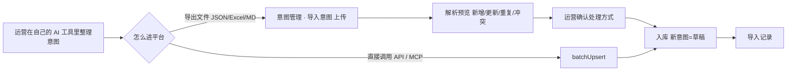
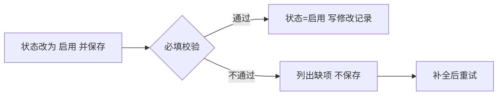
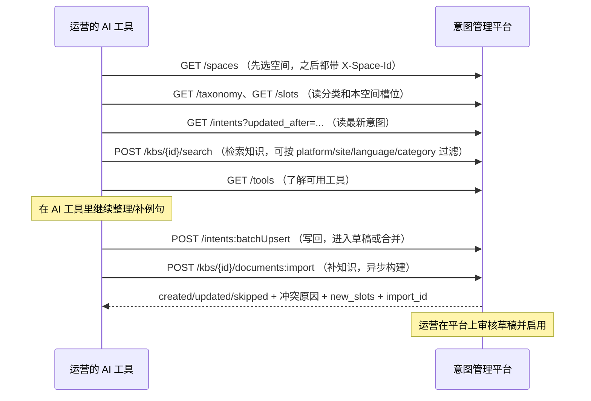

# 意图管理平台 · 全局需求文档（v0.6）

> 定位：**通用意图与知识管理平台，服务多个 Bot 和智能体**（首批：1688 智能客服、Moonclaw 跨境智能体）
> 版本：v0.6（2026-11-10，**分类层级改为按空间动态配置**（0～5 层分类 + 最后一层意图，层数和名称在空间设置里改，插入 / 删除层级先预览影响再确认）；**MCP 改为「服务 → 子工具」两级登记**（同步 tools/list、差异预览、子工具单独启停与写操作确认、意图下钻选择子工具）；openapi 0.6.0）。v0.5 MVP（2026-11-10，**取消意图级兜底，改为空间设置**（识别阈值 / 澄清 / 追问次数 / 工具重试 / 最终动作）；层级 L1 → L2 → L3 在树、清单和编辑页明确标注；Moonclaw 演示数据换为生图生视频场景 6 个 L1 / 14 个 L2 / 44 个 L3）。v0.4.3 文档备份为 `意图管理平台_全局需求文档_v0.4.3.md`。v0.4.3：开放接口并入工具中心作为「平台内置」工具，菜单减为 3 个；知识库与工具全平台通用，业务空间只管意图和槽位）。v0.4.2：工具中心新增 CLI 命令类型，共 4 种工具类型；v0.4.1 槽位改为按业务空间维护）。v0.3 文档备份为 `意图管理平台_全局需求文档_v3.md`
> 配套原型：`index.html`（单文件，离线可打开；v0.4.3 原型备份为 `index_v7.html`，v0.4.2 原型备份为 `index_v6.html`，v0.4.1 原型备份为 `index_v5.html`，v0.4 原型备份为 `index_v4.html`，v0.3 为 `index_v3.html`）

---

## 1. 目标

用一个平台把「意图」和它要用到的「知识」「工具」管在一起，按**业务空间**服务多个 Bot / 智能体，并让运营自己的 AI 工具能持续读写这份数据。

**适用场景**

| 场景 | 典型 Bot / 智能体 | 意图示例 | 平台提供 |
|---|---|---|---|
| 客服 | 1688 智能客服 | 现货确认、议价、催发货、退款 | 意图 + 问答知识 + 查库存/查物流等接口 + 空间设置（最终动作：转人工） |
| 电商设计 / 店铺装修 / 营销海报 | Moonclaw | 产品主图、卖点图、A+ 详情、店铺 Banner、大促海报 | 意图 + 平台图片规范（参考/校验）+ 违禁词库（校验）+ 生图技能 / 抠图 / 图片翻译 |
| POD / 新品开发 | Moonclaw | 印花图案、样机合成、竞品改款、配色方案 | 意图 + POD 印刷规范 + IP 侵权风险词（校验）+ 图案技能 / 样机 MCP / 西之月 CLI 爆款排行 |
| 生视频 | Moonclaw | 商品展示视频、图生视频、数字人口播、配音字幕 | 意图 + 视频规范 + 生视频技能 / 图生视频 / 数字人 / 配音字幕 |
| 预警 / 库存 | Moonclaw、客服 | 库存货期-库存查询、库存预警 | 意图 + 库存口径知识 + 通用的查库存接口 |

MVP 满足下面 6 条基本诉求：

| # | 诉求 | 对应模块 |
|---|---|---|
| 1 | 运营用自己的 AI 工具整理意图后，可以导入沉淀到平台 | 意图管理（导入意图）、工具中心 › 接入与密钥 |
| 2 | 运营在平台上管理意图，并关联知识和工具 | 意图管理 |
| 3 | 技术在工具中心注册其他平台的能力：API 接口、MCP 工具、CLI 命令、技能/工作流（如「查库存」「西之月商品详情」） | 工具中心 |
| 4 | 知识库内嵌在平台里，支持导入 | 知识库（导入文档） |
| 5 | 平台自身的接口作为「平台内置」工具开放，让运营的 AI 工具持续读写这个库，Bot 也可在意图里自循环使用（如检索知识） | 工具中心（平台内置工具、接入与密钥） |
| 6 | 一个平台服务多个 Bot / 智能体：意图和槽位按空间隔离；知识库和工具全平台通用，任何空间的意图都可关联 | 业务空间（顶栏切换，只作用于意图管理） |

**MVP 验收口径**：运营能从 AI 工具导入一批意图 → 在平台上为意图关联内嵌知识与已注册工具 → 通过必填校验后启用 → AI 工具通过 API/MCP 读到最新意图并能继续写回；每个空间的 Bot / 智能体只拉到自己空间的运行时配置。

## 2. 角色

MVP **不做权限区分**：平台不设角色切换，所有功能对所有使用者可见、可用（包括工具注册与编辑）。下表只说明日常通常由谁来做：

| 角色 | 通常做什么 |
|---|---|
| 运营 | 用自己的 AI 工具整理意图并导入；在平台上管理意图、关联知识与工具、启用/停用；维护和导入知识库 |
| 技术 | 在工具中心注册、维护其他平台的能力（API 接口 / MCP 工具 / CLI 命令 / 技能·工作流） |

各 Bot / 智能体（客服 Bot、Moonclaw 智能体等）是数据的消费方，通过平台内置工具（API / MCP）读取所在空间已启用的意图，以及全平台通用的知识和工具。

权限控制（按角色/大类分配编辑权限等）放到 V2 候选，见第 9 节。

## 3. MVP 范围

### 3.1 做什么

- **3 个菜单**：意图管理、知识库、工具中心，所有功能对所有使用者开放（原「开放接口」菜单并入工具中心：平台接口登记为「平台内置」工具，Key 与接入说明放在「接入与密钥」页签）。意图导入并入意图管理，知识只从知识库自己的导入入口导入。
- **业务空间**：顶栏切换空间，预置「1688 智能客服」「Moonclaw 跨境智能体」两个；可简单新建空间（见 5.0）。
- **分类层级按空间动态配置（v0.6）**：每个空间在「空间设置 › 分类层级」里定层数和每层名称——最后一层固定是「意图」，上面 0～5 层分类（预置两个空间都是「大类 → 问题桶 → 意图」三层：1688 12 个大类、46 个问题桶、123 个意图；Moonclaw 6 个大类、14 个问题桶、44 个意图）。意图必须挂在最末一层分类下；清单列按层级名称生成。
- **槽位按空间维护**：每个空间一份槽位列表、互不可见，入口在「意图管理 › 槽位」；意图只能从本空间槽位里选，必填/选填、追问话术可按意图设置（见 5.1）。
- **空间设置（统一兜底）**：每个空间一份——识别阈值、未识别时澄清（列候选）、澄清最多次数、槽位追问最多次数、工具失败重试、最终动作（转人工 / 交给通用助手 / 告知无法处理）。意图上**不再配置兜底条件**（见 5.1「空间设置」）。带业务规则的兜底（如议价超 3 轮转人工）放到 V2 规则引擎。
- **知识用途与标签**：关联知识分「参考 / 校验」；知识库和切片带平台、站点、语言、类目标签。
- **知识库内嵌**：沿用原系统「AI知识库」的列表、新建、详情（导入文档 / 知识库详情 / 知识库检索）形态，意图按「知识库 → 文档 → 切片」引用，不跳转外部系统。
- **状态只有三种**：草稿 / 启用 / 停用；每个意图保留简单的修改记录。

### 3.2 明确不做（MVP 以外）

| 不做 | 说明 |
|---|---|
| Langfuse 及任何评测平台集成 | 不做跳转、回归测试、发布闸门 |
| 总览 / 数据看板 | 不做 KPI、解决率、转人工率等统计 |
| 候选意图发现 | 不做语料聚类、新意图推荐与审核 |
| 版本发布 | 不做版本快照、Diff、灰度、回滚；只保留状态和修改记录 |
| 角色与权限控制 | MVP 不区分角色，所有功能对所有人开放 |
| 知识沉淀记录页、外部知识库跳转、独立的导入模块 | 知识直接内嵌，在知识库内导入；意图导入和导入记录放在意图管理内 |
| 线上运行链路 | 预处理脱敏、会话状态、路由模型、生成后校验的执行由各 Bot / 智能体负责（平台只下发规则与校验集） |
| 空间级权限、空间删除/归档、跨空间复制意图 | 放到后续迭代 |
| 快路径规则、阈值配置、工具审批流 | 放到后续迭代 |

## 4. 信息架构（菜单）

```
顶栏：业务空间切换（下拉）+「新建空间」
意图管理平台
├─ 意图管理    页签：意图列表（左：当前空间第一层分类，右：意图清单，列按层级名生成）| 槽位 | 导入记录；工具栏「导入意图」弹窗；意图编辑抽屉
├─ 知识库      AI知识库列表（全平台通用，显示全部库）→ 知识库详情（导入文档 | 知识库详情 | 知识库检索）
├─ 工具中心    页签：工具目录（外部工具 4 种类型 + 平台内置工具；MCP 按服务折叠，可展开子工具；按来源、类型筛选；注册/编辑/同步/测试调用）| 接入与密钥（API Key + REST 接口清单 + 导出运行时配置 + 给 AI 的接入说明 + MCP 配置）
（原「开放接口」菜单已取消，内容并入工具中心。）
```

## 5. 模块功能与字段

### 5.0 业务空间

- **切换**：顶栏右侧「业务空间」下拉，只在意图管理页显示并生效；知识库、工具中心页顶栏改为提示「全平台通用，不区分业务空间」。
- **按空间隔离**：意图树、意图、**槽位**、意图导入记录、运行时配置及其 version。
- **全平台通用（不区分空间）**：知识库、工具（含平台内置工具）。任何空间的意图都能关联任意知识库和工具；知识库切片「关联意图」和工具「被意图使用」显示所有空间的意图并带空间名，点击自动切换到该意图所在空间。知识的适用范围用场景标签（平台 / 站点 / 语言 / 类目）区分。
- **API Key**：可绑定一个或多个空间，绑定空间只约束意图类接口（意图、槽位、分类、运行时配置）；知识与工具类接口对所有 Key 全局可用（仍受知识 / 工具权限控制）。
- **新建空间**（简单弹窗）：名称*、描述、对应 Bot / 智能体*。新空间默认三层「大类 → 问题桶 → 意图」，带一个大类「通用（GEN）」/ 问题桶「默认」，槽位列表为空，version 从 1 开始。
- **意图编码**：第一层分类有编码时为 `{前缀}.{第一层编码}.{意图}`，没有编码时为 `{前缀}.{意图}`（最多 7 段），前缀 1～4 位大写字母；意图只能在同一个有编码的第一层分类内移动；1688 智能客服用 `B`，Moonclaw 用 `M`。编码全局唯一，已被其他空间使用时导入判为冲突。
- **去客服化**：界面文案统一用「用户」，不再出现「买家 / 客服」专属表述；「买家追问话术」改为「缺信息时追问」；原意图级「兜底处理」在 v0.5 取消，改为空间设置。

### 5.1 意图管理

**页面**
- 层级说明：页面描述按本空间层级名称写明，例如「大类 → 问题桶 → 意图」。
- 左侧：「全部」+ 当前空间**第一层**分类（显示意图数，含其下所有层），点击筛选右侧清单。没有分类层（0 层）时不显示左侧。
- 右侧清单：搜索（编码/名称/例句）、状态筛选；列：编码、意图（名称+意图描述摘要）、**每一层分类各一列（列名=层级名称）**、例句数、关联知识数、关联工具、状态、操作（编辑、启用/停用）。
- 「新建意图」：选最末一层分类（下拉显示完整路径，如「库存与货期 / 现货」）、填编码和名称，生成草稿后直接进入编辑。
- 「导入意图」：清单工具栏按钮，打开导入弹窗（见下文「导入意图」）；顶部小页签「意图列表 | 槽位 | 空间设置 | 导入记录」切换。
- 清单上直接点「启用」也会走必填校验；不通过则打开编辑抽屉并列出缺项。

**意图编辑（抽屉，5 个区块）**：抽屉标题「编辑意图 · 编码」，顶部显示归属路径，每段带层级名称（如「大类 库存与货期 / 问题桶 现货 / 意图 现货确认」）。

| 区块 | 字段 | 规则 |
|---|---|---|
| ① 基本信息 | 意图名称*、编码*（创建后不可改）、所属分类（最末一层，下拉显示完整路径；第一层有编码时只能在该分类内移动）、意图描述*、例句*（每行一条） | 编码规则见 5.0，全局唯一；意图描述 ≥ 15 个字，写作要求见下 |
| ② 槽位 | 从**本空间槽位**下拉选择（显示名 + 英文名）、必填/选填、缺信息时追问（留空＝继承槽位默认话术，输入框以灰字显示继承值）；行尾「＋ 新建槽位」弹窗快捷创建，创建后自动进入本空间槽位列表并在本意图中选中 | 槽位必须在本空间且不重复；必填槽位须有生效追问话术（本意图覆盖值或槽位默认值） |
| ③ 关联知识 | 按「知识库 → 文档 → 切片」选择（可选整篇文档），只列出对当前空间开放的知识库，可按平台/站点/语言/类目标签筛选；每条关联选择用途：**参考** / **校验** | 参考：检索后用于回答或生成；校验：生成后比对，是硬约束。切片被删除或覆盖后关联失效，会提示并移除 |
| ④ 关联工具 | 从全部工具中选择（显示工具类型；平台内置工具名后标「平台内置」，维护类内置工具不出现在下拉中）；**MCP 工具要下钻**：下拉里列的是 MCP 服务，选中后弹出该服务的子工具列表（可搜索、多选，只列已启用且远端仍存在的），意图里记录的是具体子工具，不能整体关联一个服务；入参映射按子工具的 inputSchema 生成；按工具入参逐项配置取值来源：槽位 / 常量 / 上下文（session_id、buyer_id、order_id、sku） | 必填入参必须有映射；映射的槽位必须存在；工具须对本空间开放 |
| ⑤ 单句测试 | 输入一句用户的话 | 见下文 |
| 修改记录 | 时间、操作人、改了什么（名称/意图描述/例句/槽位/关联知识/关联工具/状态）；v0.5 迁移时，原来带业务规则的兜底会写一条「已移至 V2 规则引擎」的记录 | 自动生成 |

**意图描述写作要求**：输入框下方灰色提示「这段描述会被大模型分类和语义匹配使用。请写清：用户想做什么；什么情况算这个意图；什么情况不算（容易和哪个意图混淆）。」并附示例：「用户想为商品生成符合平台规范的主图；"做主图""首图"算；只要换白底不算（→ 白底图）。」保存时少于 15 个字会提示；状态为启用时不通过则不保存。

**启用前必填校验**（状态从草稿/停用改为启用时触发，不通过不保存）：
1. 名称不为空、编码格式正确；意图描述不为空且不少于 15 个字；
2. 例句 ≥ 3 条；
3. 槽位都来自本空间槽位列表且不重复，必填槽位都有生效追问话术；
4. 至少关联 1 条知识或 1 个工具；
5. 关联的知识都存在；关联的工具都已注册、不是维护类内置工具，MCP 子工具已启用且最近一次同步时远端仍存在，必填入参都已映射、映射的入参确实存在、映射的槽位存在；
6. 意图挂在最末一层分类下。

**单句测试**：在「当前空间已启用意图 + 当前编辑中的意图」范围内做识别，**使用本空间设置的识别阈值**（结果顶部显示「使用本空间识别阈值 X（候选下限 Y）」），给出三种判定之一：
- **命中**：Top1 置信度 ≥ 阈值。继续显示槽位抽取结果、**参考知识**（切片内容）、**将执行的校验**、将调用的工具（类型 + 入参取值，并注明「失败重试 N 次，仍失败 → 最终动作」）、处理结论（缺必填槽位 → 追问话术，注明每槽位最多追问次数；否则调用工具 / 按参考知识回答 → 生成后执行 N 项校验）。
- **澄清（列候选）**：Top1 < 阈值，且有不低于候选下限的候选：显示澄清话术和最多 3 个候选（名称、编码、置信度），并注明「澄清 N 次仍不明确 → 最终动作」。
- **最终动作**：没有不低于候选下限的候选，直接显示本空间最终动作（告知无法处理时显示回复话术）。

原型中用例句相似度模拟识别（分值与真实模型不同），正式版接入线上识别服务；它只用于运营自查配置，不作为效果评测。

#### 空间设置（页签「空间设置」）

每个空间一份，对本空间所有意图生效，替代原来逐个意图配置的兜底条件。保存时有改动则本空间 version +1，无改动提示「没有改动」不升版本；「恢复默认」只回填表单，点保存才生效。

| 设置 | 规则 | 默认 |
|---|---|---|
| ① 识别阈值 | 0～1，步长 0.05。提示「数值含义由 Bot 的识别模型决定，建议用单句测试和实际对话校准」 | 0.6 |
| ② 未识别处理 | Top1 < 阈值：列出不低于**候选下限（= 阈值 ÷ 2，只读，随阈值实时显示）**的最多 3 个候选让用户选；没有候选 → 最终动作。澄清话术可配置（必填） | 「我想确认一下，您是想要以下哪一项？」 |
| ③ 澄清最多次数 | 0～5 的整数，超过 → 最终动作 | 2 |
| ④ 槽位追问最多次数 | 每个必填槽位，0～5 的整数，超过 → 最终动作 | 2 |
| ⑤ 最终动作 | 转人工 / 交给通用助手 / 告知无法处理（选它时出现「回复」话术输入框，必填） | 1688 智能客服：转人工；Moonclaw 及新建空间：交给通用助手 |
| ⑥ 工具调用失败重试 | 0～3 的整数，仍失败 → 最终动作 | 1 |

页面下方展示 Bot 运行流程：识别 → 阈值判定 → 澄清 → 槽位追问 → 知识校验 → 调用工具 → 失败重试 → 最终动作。接口：`GET /api/v1/recognition`（读）、`PUT /api/v1/recognition`（写，维护类，version +1）；运行时配置顶层输出 `recognition`。

#### 分类层级（空间设置内，v0.6）

每个空间自己定分类有几层、每层叫什么。最后一层固定是「意图」，上面可以有 0～5 层分类（预置空间是「大类 → 问题桶 → 意图」）。

| 操作 | 规则 |
|---|---|
| 改层级名称 | 直接保存，不影响数据；version +1 |
| 在某层之上插入一层 | 在每个受影响的父节点下新建一个「未分类」节点，原来的子节点挂到它下面；意图不动 |
| 删除某层 | 该层节点的子节点并到上一层；同一父节点下出现同名节点时自动合并；删除第一层时第一层编码随之丢弃（已有意图编码不变） |
| 预览 | 插入 / 删除前必须先预览：显示层级变化、分类数量变化、新建的「未分类」数、合并的节点、丢弃的编码、受影响意图数（其中启用的）和示例；确认后才执行 |
| 记录 | 每次调整 version +1，写审计日志「taxonomy.levels」，并在受影响意图的修改记录里写「分类层级调整：A → B」 |

分类树在同一页面维护：新增下级、改名、删除（有下级或有意图时不能删）；只有第一层可以设编码，第一层有意图时编码不可改。

#### 导入意图

入口：意图清单工具栏「导入意图」按钮，打开导入弹窗。流程三步：① 上传 → ② 解析预览 → ③ 完成。弹窗内提供示例文件（AI 工具产出 JSON、Excel 模板、Markdown）和「下载模板」（意图导入模板 .csv / .json / .md）。

**支持格式**

| 格式 | 说明 |
|---|---|
| JSON（推荐，AI 工具产出） | `{"intents":[{code,name,category_path[],description,examples[],slots[{name,required,ask}]}]}` 或直接数组；`category_path` 从第一层写到最末层，每段写编码或名称（旧格式 l1/l2 仍可用） |
| Excel / CSV | 表头：编码, 名称, 分类路径, 意图描述, 例句, 槽位；分类路径用「/」分隔任意层数，例句用「｜」分隔，槽位用「；」分隔（旧表头 L1, L2 仍可用） |
| Markdown | 每个意图一个小节：`## 编码 名称`，下面 `- 归属：第一层 / 第二层 / …`、`- 意图描述：`、`- 例句：a｜b`、`- 槽位：order_id(必填:追问话术)；sku` |

导入到**当前空间**；弹窗内示例文件随空间变化（Moonclaw 空间为 Moonclaw 示例）。

**解析预览的判定**

| 判定 | 条件 | 默认处理 | 可选 |
|---|---|---|---|
| 新增 | 编码不存在 | 导入（状态为草稿） | 跳过 |
| 更新 | 编码已存在且内容有差异（列出差异：名称/意图描述/新例句数） | 合并 | 覆盖、跳过 |
| 重复 | 编码已存在且内容无新增 | 跳过 | 覆盖 |
| 冲突 | 编码格式无效、编码已被其他空间使用、缺名称、文件内编码重复、与同空间其他意图同名 | 跳过 | — |

- 分类路径不存在、层数不对或没到最末一层时（`UNKNOWN_CATEGORY`），预览里给出可选的最末层分类下拉，选定后即可导入。
- **槽位**：槽位名在本空间已存在就直接使用；不存在则入库时自动在本空间新建为「文本」槽位（显示名同英文名，默认追问「请补充{名称}」），预览「说明」列提示「本空间没有的槽位将自动新建为文本槽位：…」。同义名归一放到 V2。
- **兜底字段一律忽略**：文件里带 `fallback`（JSON）、「兜底条件 / 转人工条件」列（CSV）、`- 兜底：/ - 转人工：`（Markdown）或旧格式 `human` 时不报错，该行「说明」列提示「兜底已改为空间级设置，已忽略」，入库时不写入。
- 合并：只补充新例句、新槽位，非空字段不覆盖；覆盖：替换名称、意图描述、例句、槽位，已关联的知识和工具保留。
- 已启用的意图被更新后若不再满足必填校验，自动转为草稿并写修改记录。
- 新导入的意图一律为**草稿**，关联知识/工具并通过校验后由运营启用。

#### 槽位（页签「槽位」）

每个业务空间维护自己的槽位列表，其他空间不可见；同一个英文名在不同空间是两份独立的槽位。

| 字段 | 规则 |
|---|---|
| 名称* | 英文名（小写英文/数字/下划线，本空间唯一，创建后不可改）+ 显示名 |
| 类型 | 文本 / 数字 / 日期 / 枚举 |
| 可选值 | 仅枚举类型显示且必填，逗号分隔 |
| 默认追问话术* | 意图未覆盖时使用 |

- 列表列：名称（显示名 + 英文名）、类型、可选值、默认追问话术、被哪些意图使用（本空间意图编码，可点击打开编辑；超过 6 个显示「共 N 个」弹窗）、操作（编辑、删除）。
- 新建：页签内「＋ 新建槽位」，或意图编辑槽位区的「＋ 新建槽位」快捷创建。
- 编辑：可改显示名、类型、可选值、默认追问话术；继承默认话术的意图随之生效（MVP 不触发 version 变化）。
- **删除**：被意图使用时直接禁止删除，弹窗显示被哪些意图引用（编码、名称、状态），需先在意图中移除；未被使用时确认后删除。不做联动下架。
- 初始数据：原 14 个槽位按实际被哪个空间的意图使用分配到对应空间，两边都用的各复制一份（1688：platform、sku、order_id、language、qty、target_price、reason、dest、deadline；Moonclaw：platform、site、category、sku、language、qty、product_image、style、title。category 暂无意图使用，归入 Moonclaw）。

#### 导入记录

意图管理页顶部小页签「意图清单 | 导入记录」，只显示当前空间的记录。每次通过文件导入或通过开放接口（API / MCP）写入意图都记一条。字段：编号、文件 / 调用、来源（文件上传 / AI 工具产出 / AI 工具（API））、时间、操作人（API 调用记为 Key 名称）、结果（新增 / 更新 / 跳过数量）。

### 5.2 AI知识库（内嵌，对齐原系统）

标注说明：**【原有】** 为原系统已有能力，平台内嵌时字段、文案、布局保持一致；**【新增】** 为本平台补充的需求。

#### 5.2.1 列表页【原有】

- 顶部：标题「AI知识库」，说明「AI知识库是检索增强生成（RAG）服务，支持全模态数据：富文本、表格、图片…」；右侧「设置」（检索返回切片数 TopK、相似度阈值）。
- 搜索区：「知识库名称」输入框，按钮「查询」「重置」「另存为快捷查询」（保存后以快捷查询标签展示，点击即查询）；下方「+新建」。
- 表格列：

| 列 | 说明 |
|---|---|
| 序号 | — |
| 知识名称 | 名称后以小标签显示知识库的平台/站点/语言/类目标签【新增，不加列】 |
| 知识库类型 | 「表格知识库」或「图文知识库-富文本」 |
| 状态 | 圆点 + 文字：构建成功（绿）/ 构建中 / 构建失败 |
| 最新更新时间 | 可排序 |
| 创建时间 | 可排序 |
| 操作 | 查看、编辑、删除（蓝色文字链接）；编辑改名称和标签【新增】；删除被意图关联的库时提示影响的意图【新增】 |

- 列表只显示对当前空间开放的知识库【新增】。

#### 5.2.2 新建弹窗【原有】

- 标题随所选类型变化：「创建表格知识库」/「创建图文知识库」。
- 字段：

| 字段 | 内容 |
|---|---|
| * 知识库名称 | 输入框，名称不可重复 |
| * 导入知识库 | 两张卡片二选一：**表格知识库**——列表格式的数据，比如问答对、用户数据等结构清晰、规范化的文档，支持 .xlsx .xls .csv .json .jsonl；**图文知识库**——支持图文文档内容数据，如图片、文档等，内容丰富、版面复杂的内容，支持 .docx .doc .pdf .pptx .ppt .html .htm .md .png .jpg .jpeg .webp |
| * 导入文件 | 「上传文件」按钮；下方提示：「支持扩展名：…，请保证表头完全一致！」「请上传文件，若文件过大，导入可能花费5～30分钟不等，请耐心等待。」「若导入新的文件，系统将校验上传的文档内容和名称，若与已有的文档相同，则覆盖并更新原文档。」 |

- 【新增】适用范围标签（平台 / 站点 / 语言 / 类目，逗号分隔）。知识库全平台通用，不选空间。
- 底部按钮：「取消」「确定，并导入」。导入后状态先为「构建中」，构建完成变为「构建成功」（失败为「构建失败」）。

#### 5.2.3 详情页【原有】

以顶部标签页打开，标签标题「知识库详情」（可关闭，返回「AI知识库」标签）。

- 头部：图标、知识库名称、绿色状态徽标、「更新时间：」「知识库类型：」，以及「标签：」【新增】。
- 三个页签：

| 页签 | 内容 |
|---|---|
| 导入文档 | 蓝色「导入文档」按钮（同新建弹窗的导入逻辑），右侧「请输入文档名称」搜索框。表格列：序号、文档名称、构建状态（绿色徽标）、数据量（表格库为条数，图文库为字符数）、上传时间、更新时间、操作（切片详情、删除） |
| 知识库详情 | 顶部文档下拉（全部文档 / 单个文档）。表格列：序号、所属文档、知识切片、**关联意图【新增】**、更新时间、操作（查看） |
| 知识库检索 | 输入问题，返回命中切片、所属文档和相似度（按 TopK 和阈值过滤）；【新增】平台 / 站点 / 语言 / 类目四个标签筛选下拉，结果多一列「标签」 |

#### 5.2.4 新增需求

| 新增 | 说明 |
|---|---|
| 关联意图 | 切片列表多一列「关联意图」，显示引用该切片的意图编码，点击打开意图编辑 |
| 切片编辑 | 切片「查看」弹窗内可直接编辑（表格库按表头逐列编辑，图文库编辑正文），保存后更新时间刷新，并在关联意图的修改记录中留痕 |
| 覆盖影响提示 | 同名或同内容覆盖导入时，若原文档中被意图关联的切片在新文件中不存在，列出受影响的意图（编码、名称、状态、文档、切片序号），须勾选「我已知晓影响，确认覆盖」才能导入；导入后移除失效关联，已启用意图若因此校验不通过自动转为草稿并记录 |
| 对外写入接口 | 运营的 AI 工具可通过平台内置工具（API / MCP）导入文档、编辑切片、检索知识，不需要 X-Space-Id（见第 8 节） |
| 不区分空间 | 知识库全平台通用，列表始终显示全部，切换空间不影响；任何空间的意图都可关联；切片「关联意图」列显示所有空间的意图（带空间名） |
| 适用范围标签 | 知识库和切片都可设置 platform / site / language / category 标签（多值）；切片未设置的类别继承知识库标签；标签为空表示不限。切片「查看」弹窗可编辑切片标签（留空＝继承）；检索、意图知识选择器、内置工具「检索知识」都可按标签过滤 |

**新增演示知识库（均为示例，非真实平台规则，内容带「示例」字样）**

| 知识库 | 类型 | 主要使用场景 | 内容 |
|---|---|---|---|
| 违禁词库 | 表格（列：词、平台、站点、语言、类型、替换建议） | 1688 智能客服、Moonclaw | 15 条示例行，每行按平台/站点/语言打切片标签 |
| 平台图片规范 | 图文 | Moonclaw | 6 篇：TikTok 美区主图、Shopee 越南主图、Amazon 美国主图与辅图、Temu 主图、Amazon A+ 模块、图片翻译与本地化（22 个切片） |
| 视频规范 | 图文 | Moonclaw | 4 篇：TikTok 商品视频、Amazon 主图视频、Shopee 视频、数字人口播与配音（12 个切片） |
| POD 印刷规范 | 图文 | Moonclaw | 分辨率、出血、印刷区域、色彩、透明底等 6 个切片 |
| IP / 侵权风险词 | 表格（列：词、类型、风险说明、建议） | Moonclaw | 10 行（品牌、角色、球队、商标词示例），POD / 新品开发作校验 |
| 节日营销日历 | 表格 | Moonclaw | 9 行（黑五、网一、圣诞、双 11、开斋节等，含站点、时间、建议主题） |
| 店铺装修规范 | 图文 | Moonclaw | Banner、店招、分类图标、首页模块等 5 个切片 |

Moonclaw 新增知识每条切片都以「【示例，非真实平台规定】」开头。

#### 5.2.5 导入规则（同一套逻辑，用于新建弹窗和详情页「导入文档」，知识只能从这两处导入）

1. 扩展名必须属于所选类型的支持列表。
2. 表格知识库：同一知识库内所有文件表头必须完全一致（列名与顺序），首个文件确定表头；不一致直接拒绝并展示两边表头。每行数据构建为一个切片。
3. 图文知识库：服务端提取正文并切分为切片（图片做 OCR）。
4. 与已有文档**名称或内容相同**即覆盖并更新原文档：表格库按首列匹配、图文库按切片内容匹配，匹配上的切片保留 ID 和意图关联。
5. 导入异步构建，文档列表显示构建状态、上传时间和更新时间。

### 5.3 工具中心

只有工具目录一个页面（槽位已移到「意图管理 › 槽位」）。

平台**只登记**工具（怎么调、要什么参数、在哪些空间可用），实际执行在各 Bot / 智能体（执行规则见 5.4 运行时配置与 `AI接入说明.md` 第 12 节）。

工具全平台通用，不区分业务空间。工具中心两个页签：**工具目录** | **接入与密钥**。

- **列表**（显示全部工具，切换空间不影响）：顶部两组筛选，带数量——「按来源」（全部 / 外部 / 平台内置）、「按类型」（全部 / API 接口 / MCP 工具 / CLI 命令 / 技能/工作流）。列：显示名+工具名、类型标签、来源（外部 / 平台内置 + 「维护类」或「可在意图中使用」）、描述、接入信息（API：方法+地址；MCP 服务：传输方式+地址/命令+鉴权+最近同步；MCP 子工具：tools/call 工具名；CLI：命令模板+鉴权+输出格式；技能/工作流：ID+平台；平台内置：合并的 REST 路径 + 对应 MCP 工具 + 是否需要 X-Space-Id）、入参（* 为必填）、被哪些意图使用（所有空间，带空间名，可跳转）、操作（测试调用；外部工具可编辑，平台内置显示「平台提供，不可编辑 / 删除」）。
- **注册/编辑**（选择类型后只显示该类型的字段，界面保持简单）：

| 字段 | 规则 |
|---|---|
| 工具类型* | API 接口 / CLI 命令 / 技能/工作流，切换后表单随之变化（MCP 改为「注册 MCP 服务」，见下文） |
| 工具名* | 小写英文/数字/下划线，唯一，注册后不可改 |
| 显示名*、描述* | 描述写清用途，运营据此选择工具 |
| API 接口（HTTP） | 接口地址*（http(s)）、方法（GET/POST/PUT/DELETE）、鉴权方式（无 / API Key / Bearer Token / OAuth2，密钥由平台加密托管）、入参、出参示例（合法 JSON） |
| CLI 命令 | 可执行程序*（如 `xclaw-cli`）、已验证版本、命令/子命令模板*（以可执行程序开头，用 `{参数名}` 引用入参；选填参数为空时连同前面的 `--选项` 一起省略）、入参、鉴权方式（无 / CLI 内置登录（OAuth）/ 环境变量 Token）、登录/鉴权命令（如 `xclaw-cli auth login`）、安装方式（所需环境）、输出格式（JSON / 纯文本）、「写操作，Bot 执行前需用户确认」、输出说明/示例。校验：模板引用的 `{参数}` 必须已定义，每个入参都必须出现在模板中 |
| 技能/工作流 | 技能或工作流 ID*、所属平台*、入参、输出说明 |
| 入参 | 参数名、类型（string/number/boolean）、是否必填、说明；参数名不可重复（API / CLI / 技能手工填写；MCP 子工具由同步到的 inputSchema 生成） |
| 负责人* | — |

- 意图里的工具入参映射（槽位 / 常量 / 上下文）对 4 种类型完全一致，运营不需要关心工具类型。

#### MCP 服务（v0.6）

第三方 MCP 一般不是一个原子能力，而是一个服务里打包一批工具。工具中心按「**服务 → 子工具**」两级登记：

| 步骤 | 规则 |
|---|---|
| 注册 MCP 服务 | 服务名*（小写英文 / 数字 / 下划线，唯一）、显示名*、说明、传输方式*（Streamable HTTP / SSE（旧版）/ stdio）、服务地址*（HTTP / SSE）或 启动命令* + 参数 + 环境变量（stdio）、鉴权（无 / Bearer Token / API Key（可改请求头名）/ 环境变量（仅 stdio））、密钥（加密托管，只写不读）、负责人* |
| 同步工具 | 「在线同步」：平台连接服务执行 initialize + tools/list（自动翻页）；「手动导入 JSON」：粘贴 tools/list 的返回（JSON-RPC 响应、`{"tools":[…]}` 或数组）。stdio 服务默认不在平台服务器上执行命令（需运维设置 `IP_MCP_STDIO_ENABLED=true` 且仅管理员可在线同步），一般用手动导入 |
| 差异预览 | 同步先预览、确认后生效：**新增**（绿）、**变更**（黄，列出新增 / 删除入参、必填变化、类型变化、说明变化、「远端重新出现」）、**消失**（红）、未变数量。消失的工具如果仍被意图使用：**保留并标红**，列出受影响意图，不会静默删除；没人用的直接从目录删除 |
| 确认同步后 | 用到已消失工具或因变更不再通过校验的**已启用意图自动转草稿**并写修改记录；相关空间 version +1；写审计日志「mcp.sync」 |
| 子工具 | 名称为 `{服务名}.{远端工具名}`；可单独**启用 / 停用**、标记「**写操作需确认**」（同步时按 annotations 预填：readOnlyHint=false 或 destructiveHint=true 时默认勾选）；说明和入参来自同步，不能手工编辑或单独删除；停用后用到它的已启用意图转草稿 |
| 列表 | 每个 MCP 服务一行（工具数、启用数、远端已消失数、传输方式、地址、鉴权、最近同步），点开展开子工具行；被意图使用的服务不能删除 |

- 意图绑定 MCP 时必须下钻到子工具（见 5.1 ④），不能绑定整个服务。
- 运行时配置导出 `mcp_servers`（只含被已启用意图用到的服务）和用到的子工具（含 inputSchema）；**密钥不导出**，只给环境变量名 `auth.token_env`（默认 `MCP_{服务名大写}_TOKEN`）。
- 平台内置的 `intent_platform` 服务由平台维护，不可编辑、不可同步。
- v0.6 迁移：原来一条 MCP 工具一条记录（Server URL + 工具名）的数据，按 Server URL 归为服务（服务名取 URL 最后一段，平台内置为 `intent_platform`），工具改名为 `{服务名}.{原 MCP 工具名}`，意图里的绑定同步改名。没有凭空补充第三方工具。

#### 平台内置工具

平台自身的接口也是工具：可以在意图里自循环使用（如让 Bot 在回答前检索知识），也开放给其他 AI 调用。内置工具由平台提供，**不可编辑、不可删除**，类型为 API 或 MCP；把 19 个 REST 路径和 6 个 MCP 工具合并为 8 个能力：

| 工具 | 类型 | 合并的接口 | 空间 | 分类 |
|---|---|---|---|---|
| 检索知识 `intent_platform.search_knowledge`（平台内置 MCP 服务 `intent_platform` 的子工具） | MCP | `search_knowledge`；`POST /kbs/{kb_id}/search` | 全局 | 读取，可在意图中使用 |
| 读取知识库 `pf_read_knowledge` | API | `GET /kbs`、`/kbs/{kb_id}/documents`、`/kbs/{kb_id}/chunks`、`/imports/{import_id}` | 全局 | 读取，可在意图中使用 |
| 读取意图与槽位 `pf_read_intents` | API | `GET /spaces`、`/taxonomy`、`/slots`、`/intents`、`/intents/{code}`；MCP `list_intents`、`get_intent` | 按空间 | 读取，可在意图中使用 |
| 读取工具目录 `pf_list_tools` | API | `GET /tools`；MCP `list_tools` | 全局 | 读取，可在意图中使用 |
| 读取运行时配置 `pf_runtime_config` | API | `GET /runtime-config` | 按空间 | 读取，可在意图中使用 |
| 写回意图 `pf_write_intents` | API | `POST /intents:batchUpsert`、`PATCH /intents/{code}`；MCP `upsert_intents` | 按空间 | **维护类** |
| 槽位写入 / 删除 `pf_write_slots` | API | `POST /slots`、`PUT /slots/{name}`、`DELETE /slots/{name}` | 按空间 | **维护类** |
| 导入 / 编辑知识 `pf_import_knowledge` | API | `POST /kbs/{kb_id}/documents:import`、`PUT /kbs/{kb_id}/chunks/{chunk_id}`；MCP `import_knowledge` | 全局 | **维护类** |

- **维护类**（写入 / 修改意图、导入知识、槽位写入 / 删除）：在意图「关联工具」下拉中不出现，启用校验也会拦截；只给维护用 AI 通过 API Key 调用。
- **读取类**：可在任何空间的意图里关联，入参映射与外部工具相同；按空间的读取类工具在运行时使用调用方 Bot 所在空间。

- 编辑工具新增必填入参时，在使用该工具的意图上写修改记录提醒补映射（已启用意图下次保存会被校验拦住）。
- **测试调用**（四种类型都支持，原型模拟）：按入参填写测试值，校验必填，显示请求与响应。API 显示方法+地址+请求体；CLI 显示按模板拼好的完整命令行（`$ xclaw-cli ...`）和退出码、输出说明（原型不真实执行命令）；技能/工作流显示技能 ID、平台、inputs 和运行结果；MCP 显示服务连接信息和 JSON-RPC `tools/call` 请求。

### 5.4 工具中心 › 接入与密钥（原「开放接口」页）

平台内置工具的调用方式，供运营的 AI 工具、维护用 AI 以及各 Bot / 智能体读写本平台。意图类接口（意图、槽位、分类、运行时配置）按空间处理：请求头 `X-Space-Id` 或 query 参数 `space`，必须是 Key 绑定的空间之一，否则 403；知识与工具类接口全局可用，不需要 X-Space-Id。页面顶部有「示例与运行时配置使用的空间」下拉（只影响本页示例、模拟调用和导出）。

- **API Key 管理**：新建（名称 + 绑定空间（多选，至少 1 个）+ 权限：意图读/写、知识读/写、工具读），完整 Key 只在创建时显示一次；列表显示全部 Key，含绑定空间（意图 / 槽位）、归属、权限、创建时间、最近调用、状态；可吊销。绑定空间只约束意图类接口，知识与工具类权限对所有空间生效。
- **REST 接口清单**新增「空间」列：按空间的标「X-Space-Id」，知识库 / 工具 / 导入任务标「全局」；所有接口都已合并登记为工具目录里的平台内置工具。
- **REST 接口**、**MCP 服务**：见第 8 节。
- 意图写接口复用意图管理「导入意图」的校验与判定逻辑，并在「意图管理 › 导入记录」留下「AI 工具（API）」记录；知识写接口复用知识库导入规则（5.2.5）。
- **导出运行时配置（按空间）**：说明「供 {空间对应 Bot} 拉取本空间已启用意图的完整配置」；接口 `GET /api/v1/runtime-config`（带空间，`since_version` 增量，响应带 `version`）；「下载当前配置 JSON」按钮导出**当前空间**（文件名 `runtime-config_{空间}_v{版本}.json`）。内容：
  - `space`（id、name、bot）、`version`、`generated_at`；
  - `recognition`：本空间的空间设置 `{threshold, candidate_min, max_candidates, max_clarify, max_slot_ask, tool_retry, final_action(handoff_human / general_assistant / decline), final_action_label, clarify_prompt, final_message}`；
  - `slots`：本空间的槽位定义（名称、显示名、类型、可选值、默认追问）；
  - `intents`：只含已启用意图，每个带 code、name、category_path、description、examples、slots（required、生效 ask、是否覆盖）、knowledge（kb_id / doc_id / chunk_id，`usage`：reference / validate）、tools（工具、`type`：http / mcp / cli / skill、入参映射；mcp 另带 `server`、`mcp_tool`）；每个意图带 `category_path`（从第一层到最末层的 `{code, name}`）；
  - `taxonomy`：本空间层级定义 `levels`（每层 depth、name，最后一层是意图）与分类树 `categories`；
  - `mcp_servers`：已启用意图用到的 MCP 服务连接信息（transport、url 或 command/args/env、auth）；**不含密钥**，`auth.token_env` 给出 Bot 侧保存密钥的环境变量名；
  - `validation_sets`：所有「校验」知识的**完整切片内容**（含表格 cells 和标签、被哪些意图使用）；整篇文档关联时导出全部切片；
  - `tools`：本空间已启用意图**引用到的**工具（外部或平台内置，工具全局通用，不再按空间登记），含类型、`source`（external / builtin；内置工具另带 maintenance、space_scoped、endpoints、mcp_tools）及类型特有字段、入参 schema（http：method、url、auth；mcp：server、mcp_server（连接信息）、mcp_tool、input_schema、confirm_required，只导出被用到的子工具；cli：`cli{bin, command_template, auth, login_command, install, verified_version, output_format, confirm_required, output_description}`；skill：skill_id、platform、output_description）。
  - **Bot 执行规则**（平台只登记，执行在 Bot）：http 按 method+url 发请求（GET 放 query，其他放 JSON body），凭据由 Bot 侧托管；mcp 按 mcp_server 连接（同一服务一个会话）调 `tools/call`，confirm_required 时先向用户确认；cli 在 Bot 运行环境执行命令模板（未安装按 install 安装，未授权按 login_command 引导授权，选填空值省略对应 `--选项`，按参数数组执行不拼 shell，json 输出解析 stdout，confirm_required 时先向用户确认）；skill 在对应平台运行 skill_id。入参统一按 param_map（槽位/常量/上下文）取值。
  - 提示：「本空间的意图启用、停用或编辑后，version 会递增（各空间版本独立）；Bot 发现版本变化后应重新拉取，并清空意图识别缓存。」
- **version 维护**（每个空间独立）：修改空间设置，启用、停用意图，编辑已启用意图（含导入合并、知识删除/覆盖、工具变更导致已启用意图变化）、调整分类（新增 / 改名 / 删除分类、改层级）、MCP 同步或子工具启停影响已启用意图时，该空间 version +1。

## 6. 核心流程

### 6.1 导入（AI 工具整理 → 平台）



### 6.2 关联（意图 ↔ 知识、工具）

1. 运营在意图管理里打开草稿意图，补全意图描述、例句、槽位；
2. 从本空间槽位选槽位（没有就点「＋ 新建槽位」），设置必填/选填，需要时覆盖追问话术；
3. 「从知识库选择」：先选知识库（仅本空间可用），可按标签筛选，再选文档，勾选切片或整篇文档；为每条关联选「参考 / 校验」；
4. 选择工具（技术已在工具中心注册的外部工具，或读取类平台内置工具；全部空间通用），逐个入参配置取值：槽位 / 常量 / 上下文；
5. 用单句测试（按本空间阈值）确认能命中、不会落到澄清或最终动作、槽位能抽到、参考与校验知识齐全、工具入参齐全；识别阈值、澄清和最终动作在「空间设置」统一调整。

### 6.3 启用



停用不做校验；停用的意图不会被 Bot 读取（`status=启用` 过滤）。

### 6.4 外部 AI 调用（持续读写）



## 7. 数据模型

```
Space 业务空间
  id PK · name · description · bot(对应 Bot/智能体) · version(运行时配置版本，空间内递增) · levels[](层级名称，最后一个是意图，0～5 层分类)
  recognition { threshold(0~1, 默认 0.6) · candidate_min(=threshold/2，计算) · max_clarify(2) · max_slot_ask(2) · tool_retry(1) · final_action(转人工/交给通用助手/告知无法处理) · clarify_prompt · final_message · updated_at · updated_by }

RuntimeConfig 运行时配置（导出视图，按空间，不单独存储）
  space · version · generated_at · recognition[空间设置] · taxonomy[层级定义 + 分类树] · slots[本空间槽位定义] · intents[已启用意图完整配置，含 category_path] · validation_sets[校验知识全文] · mcp_servers[用到的 MCP 服务连接信息，无密钥] · tools[类型、入参 schema]

SlotDef 槽位（按空间）
  space FK · name（英文，空间内唯一，不可改） · display_name · type(文本/数字/日期/枚举) · options[]（仅枚举） · default_ask

Intent 意图
  code PK · space FK · name · category FK(最末一层分类) · description(意图描述) · examples[] · status(草稿/启用/停用) · owner · updated_at
  slots[]      { name → 本空间 SlotDef.name, required, ask(覆盖值，空=继承 default_ask) }
  kb_refs[]    { kb_id, doc_id, chunk_id(* = 整篇), usage(参考/校验) }
  tool_binds[] { tool_name, param_map{ param: {source: 槽位|常量|上下文, value} } }
  change_log[] { at, by, message }

Category 分类（邻接表，每个空间一棵树；1688 来自脑图，新空间默认「通用/默认」）
  id PK · space FK · parent FK(空=第一层) · depth · code(仅第一层可有，空间内唯一) · name(同一父节点下唯一) · position
  意图 = 最末一层分类下的 Intent

ScopeTags 标签 { platform[], site[], language[], category[] }

KnowledgeBase 知识库
  id PK · name · type(表格知识库/图文知识库-富文本) · status(构建中/构建成功/构建失败) · headers[]（表格库） · tags(ScopeTags)（不区分空间） · created_at · updated_at

Document 文档
  id PK · kb_id FK · name · status(构建中/构建成功/构建失败) · data_size · uploaded_at · updated_at

Chunk 知识切片
  id PK · doc_id FK · order · content · cells{表头: 值}（表格库） · tags(ScopeTags，未设置的类别继承知识库) · updated_at
  关联意图 = Intent.kb_refs 反查

Tool 工具
  name PK · display_name · description · type(API 接口/MCP 工具/CLI 命令/技能·工作流) · params[] · builtin(平台内置) · maint(维护类) · scope(global/space) · rest[] · mcp[]（不区分空间）
  API：url · method · auth · output_example；CLI：bin · command_template · auth · login_command · install · verified_version · output_format · confirm_required · output_description；技能/工作流：skill_id · platform · output_description；MCP 子工具：name = {服务名}.{远端工具名} · server FK · mcp_tool · input_schema · annotations · confirm_required · enabled · remote_missing

McpServer MCP 服务
  name PK · display_name · description · transport(streamable_http / sse / stdio) · url | command + args + env · auth(无/Bearer Token/API Key/环境变量) · auth_header · auth_env · secret(加密，只写不读) · source(external/builtin) · owner · last_sync_at/by/source

ImportRecord 意图导入记录
  id PK · space FK · file · source(文件上传/AI 工具产出/AI 工具（API）) · at · by · result

ApiKey
  id PK · name · owner · spaces[](绑定空间，1 个或多个，只约束意图类接口) · scopes[] · created_at · last_used_at · status(有效/已吊销)
```

## 8. 平台内置工具的接口清单（原开放接口）

鉴权：`Authorization: Bearer ipk_xxx`，按 Key 权限控制读写。空间：意图类接口（spaces、taxonomy、slots、intents、runtime-config）带 `X-Space-Id` 请求头或 `space` 查询参数（都不传时用 Key 绑定的第一个空间；不在绑定空间内 403 `SPACE_FORBIDDEN`）；知识库（kbs、imports）和工具（tools）接口全局可用，不需要也会忽略 X-Space-Id。

### 8.1 REST

完整定义见 `openapi.yaml`（OpenAPI 3.0.3，已通过校验）。

| 方法 | 路径 | 权限 | 说明 |
|---|---|---|---|
| GET | /api/v1/spaces | 意图:读 | 业务空间列表（只返回 Key 绑定的空间） |
| GET | /api/v1/taxonomy | 意图:读 | 当前空间层级定义 levels 与分类树 categories（写入前先读） |
| GET | /api/v1/slots | 意图:读 | 当前空间槽位列表（按 X-Space-Id；写意图前先读，优先复用） |
| POST | /api/v1/slots | 意图:写 | 在当前空间新建槽位（本空间同名 409） |
| PUT | /api/v1/slots/{name} | 意图:写 | 修改当前空间槽位的显示名、类型、可选值、默认追问（英文名不可改） |
| DELETE | /api/v1/slots/{name} | 意图:写 | 删除当前空间槽位；被意图使用时 409 SLOT_IN_USE 并返回引用的意图 |
| GET | /api/v1/intents | 意图:读 | 列表；参数 category（分类 id，含子分类）、status、q、updated_after、page、page_size；l1 / l2 已废弃但仍可用 |
| GET | /api/v1/recognition | 意图:读 | 当前空间的空间设置（识别阈值、澄清、追问次数、工具重试、最终动作） |
| PUT | /api/v1/recognition | 意图:写 | 更新空间设置，有改动时 version +1（维护类） |
| GET | /api/v1/intents/{code} | 意图:读 | 详情：例句、槽位、关联知识及用途、工具映射 |
| POST | /api/v1/intents:batchUpsert | 意图:写 | 批量写入当前空间；mode=merge；新增为草稿；冲突跳过并返回原因；已启用意图不可 overwrite；返回 new_slots |
| PATCH | /api/v1/intents/{code} | 意图:写 | 修改草稿意图字段；不可设为启用（403） |
| GET | /api/v1/kbs | 知识:读 | 全部知识库（类型、状态、表头、标签），全局 |
| GET | /api/v1/kbs/{kb_id}/documents | 知识:读 | 文档列表（构建状态、数据量、上传/更新时间） |
| POST | /api/v1/kbs/{kb_id}/documents:import | 知识:写 | 导入文档，202 异步构建；表头不一致 400；同名/同内容未确认覆盖 409（返回受影响意图） |
| GET | /api/v1/kbs/{kb_id}/chunks | 知识:读 | 切片列表（含标签、生效标签、关联意图）；参数 doc_id、q |
| PUT | /api/v1/kbs/{kb_id}/chunks/{chunk_id} | 知识:写 | 编辑单个切片（含标签） |
| POST | /api/v1/kbs/{kb_id}/search | 知识:读 | 检索，返回命中切片与相似度；可按 platform / site / language / category 过滤 |
| GET | /api/v1/imports/{import_id} | 知识:读 | 查询导入任务结果 |
| GET | /api/v1/tools | 工具:读 | 全部工具（外部 + 平台内置；类型、来源、类型特有字段、入参；MCP 子工具带所属服务连接信息），全局 |
| GET | /api/v1/runtime-config | 意图:读 | 当前空间运行时配置：已启用意图完整配置 + 空间设置 recognition + 槽位定义 + 知识用途 + validation_sets 全文 + 工具类型；响应带 version，支持 since_version 增量（无变化返回 304）；整理意图时不要用 |

通用约定：写请求必须带 `Idempotency-Key`（24 小时内同 Key 返回首次结果）；单次最多 100 条；每个 Key 每分钟最多 60 次，超出 429 并返回 `Retry-After`。

### 8.2 MCP

服务地址 `https://intent.example.com/mcp`，使用同一 API Key（请求头可带 `X-Space-Id`）。仍为 6 个工具，意图类工具（list_intents、get_intent、upsert_intents）可传 `space` 参数，知识与工具类（search_knowledge、import_knowledge、list_tools）全局；name、description、inputSchema 见 `AI接入说明.md` 第 9 节。

| MCP 工具 | 对应 REST |
|---|---|
| list_intents | GET /intents；view=taxonomy → GET /taxonomy；view=slots → GET /slots（本空间槽位）；view=spaces → GET /spaces |
| get_intent | GET /intents/{code} |
| upsert_intents | POST /intents:batchUpsert（仅 merge） |
| search_knowledge | POST /kbs/{kb_id}/search（同样支持 platform / site / language / category 过滤） |
| import_knowledge | POST /kbs/{kb_id}/documents:import |
| list_tools | GET /tools |

### 8.3 面向 AI 的接入说明

工具中心「接入与密钥」页签的「给 AI 的接入说明」区块：以纯文本代码块展示两个文件，每个文件提供「复制」「下载」按钮，运营把它们交给自己的 AI 工具。

| 文件 | 内容 |
|---|---|
| `AI接入说明.md` | 平台是什么（多空间）；工作流（**先选空间** → 读分类、本空间槽位和已有意图并查重 → 用 merge 写回 → 写回均为草稿，不启用）；编码规则、意图描述 ≥ 15 字、例句 ≥ 3 条；**槽位规则**（按空间、先读后用、优先复用、不建同义槽位）；**空间设置与 Bot 运行流程**（识别→阈值判定→澄清→槽位追问→知识校验→调用工具→失败重试→最终动作）；**知识用途与标签过滤**；禁止事项；常见错误及处理；6 个 MCP 工具定义；分类层级与 category_path；MCP 服务与 token_env；错误码表；限制 |
| `openapi.yaml` | OpenAPI 3.0.3，覆盖第 8.1 节全部接口，含字段类型、必填、枚举、示例；description 写给 AI 看，说明何时用、何时不用 |

错误码（AI 下一步怎么做）：

| HTTP | 含义 | AI 下一步 |
|---|---|---|
| 400 | 参数或文件格式错误（表头不一致、扩展名不支持等） | 按 code/details 修正后重试，不原样重试 |
| 401 | Key 缺失、无效或已吊销 | 停止调用，请运营检查或新建 Key |
| 403 | 无权限、空间不符或被规则禁止（启用、改已启用意图） | 不重试，转交运营 |
| 404 | 对象不存在 | 重新列表查询确认 ID |
| 409 | 覆盖需确认 / 槽位已存在或仍被使用 / Idempotency-Key 被不同请求体复用 | 覆盖类等运营确认；幂等类换新 Key |
| 413 | 超过 100 条或文件过大 | 拆批 |
| 422 | 内容校验不通过 | 按 details 补全，只重提问题条目 |
| 429 | 超过每分钟 60 次 | 按 Retry-After 等待，合并请求 |

## 9. 后续迭代（V2 候选）

| 候选 | 说明 |
|---|---|
| 关键词规则 | 意图级关键词/正则快路径，命中直接路由 |
| 优先级 | 多意图同时命中时的优先级与互斥规则 |
| 分大类阈值 | 在空间阈值之上，按第一层分类覆盖识别置信度阈值 |
| 规则引擎（业务兜底规则） | v0.5 取消意图级兜底后，带业务含义的规则统一在这里配置（条件 + 动作，支持 且/或、对话轮次、槽位数值、关键词），并由平台侧统一执行校验集。待迁入的规则（来自 1688 智能客服原兜底，已在对应意图写修改记录）：<br>· B.STOCK.AVAIL 现货确认：用户要求**承诺**到货日期 → 转人工<br>· B.STOCK.RESTOCK_ETA 补货时间：用户要求**赔偿**延期损失 → 转人工<br>· B.PRICE.BARGAIN 议价：**议价超过 3 轮**或问**底价** → 转人工<br>· B.ORDER.REPRICE 改价：**改价金额超过 ¥5000** → 转人工<br>· B.REL.ESCALATE 升级投诉：提到**投诉 / 差评** → 转人工<br>· B.REL.WECHAT 加微信：提到**微信** → 转人工<br>· B.AS.REFUND 退款：提到**投诉** → 转人工<br>（B.AS.DAMAGE「订单号为空 → 澄清」已由必填槽位追问覆盖，不迁移） |
| 候选意图发现 | 从会话/打标结果中聚类未覆盖诉求，运营审核后建为新意图 |
| 版本发布 | 意图库快照、版本 Diff、发布/回滚、Bot 按版本拉取 |
| 效果评测 | 标准测试集回归、识别准确率/解决率/转人工率看板（可接 Langfuse 等评测平台） |
| 槽位同义名归一 | 导入/写入时把同义槽位名（如 数量/quantity → qty、商品/链接 → sku）自动归一到已有槽位 |
| 槽位删除影响提示与联动 | 删除被使用的槽位时列出影响并联动移除（含工具入参映射），已启用意图失效自动转草稿；MVP 只做禁止删除 |
| 槽位变更触发版本 | 编辑槽位（如默认追问话术）时，使用它的已启用意图所在空间 version +1 |
| 槽位正则校验 | 文本/数字/日期类槽位的正则校验规则 |
| 权限控制 | 角色区分、空间级权限、按大类分配负责人与编辑权限、操作审计 |
| CLI 命令导入 | 从 CLI 的命令元数据（如 `xclaw-cli schema <pack> <domain> <capability> <action> --json`）一键生成工具的命令模板与入参，并同步风险等级 / 确认策略 |
| 平台侧代执行 | 平台提供工具执行网关（含 CLI 沙箱与凭据托管），Bot 只调平台；MVP 执行在 Bot |
| 空间级知识 / 工具权限 | 如需按空间限制某些知识库或工具的可见范围，再引入可见性配置（MVP 全平台通用） |
| 其他 | 工具治理（写操作审批、调用监控）；知识增强（切片策略、过期提醒）；空间归档与跨空间复制意图 |

## 10. 原型说明

- 文件：`index.html`，单文件离线打开；数据存在浏览器 localStorage，右上角「重置演示数据」可恢复初始状态。
- 种子数据：
  - 空间「1688 智能客服」（大类 → 问题桶 → 意图）：12 个大类、46 个问题桶、123 个意图（15 个已配置并启用）；原意图级兜底已取消，其中 7 条业务规则写入修改记录并列入 V2 规则引擎（见第 9 节）；空间设置默认：阈值 0.6、最终动作转人工；
  - 空间「Moonclaw 跨境智能体」（生图生视频场景）：**6 个大类、14 个问题桶、44 个意图**（启用 38、草稿 4、停用 2），每个意图都有编码、名称、≥15 字意图描述（含边界）、≥3 条例句、槽位（必填/选填与追问）、关联知识（参考/校验）、工具与入参映射，不配兜底条件；空间设置默认：阈值 0.6、最终动作交给通用助手。层级如下（括号内为意图）：
    - **电商设计（DESIGN）**：主图与白底图（产品主图、白底图、多平台主图适配）；辅图与卖点图（场景图、细节图、尺寸图、卖点图）；详情页（A+ 详情、详情长图、图片翻译）
    - **POD 开发（POD）**：图案设计（印花图案生成、无缝图案、按趋势出图、文字 / Slogan 设计·草稿）；样机与上身（样机合成、图案上身 / 模特图、多色款展示）
    - **新品开发（NPD）**：款式开发（竞品改款、新品概念图、爆款参考选款）；配色与包装（配色方案、包装效果图、材质替换预览·草稿）
    - **店铺装修（SHOP）**：店铺视觉（店铺 Banner、店招 / Logo、分类图标）；页面装修（店铺首页、品牌故事页·草稿）
    - **营销海报（MKT）**：大促与节日（大促海报、节日海报、营销日历选题）；社媒与活动（社媒帖子图、优惠券图、主题活动图、达人种草图·停用）
    - **视频（生视频）（VIDEO）**：商品视频（商品展示视频、图生视频、开箱视频·停用）；带货与广告（数字人口播、短视频广告、直播切片·草稿）；视频后期（视频封面、多语种配音、字幕翻译）
  - 西之月 CLI 只用文档中真实存在的两个命令：`xclaw-cli mall mall-product detail get`（卖点图 M.DESIGN.SELLING_POINT 取商品详情）和 `xclaw-cli mall mall-product rank-list query`（M.POD.TREND_ART 按趋势出图、M.NPD.TREND_REF 爆款参考选款），没有新增其他命令；
  - 11 个知识库（全平台通用）：1688 客服用 4 个（测试知识库、销售助手-帮助中心-常见问题-禁删、客服AQ、业务规则文档），两个场景共用违禁词库，Moonclaw 新增 6 个——平台图片规范（6 篇：TikTok / Shopee 越南 / Amazon 美国 / Temu 主图、Amazon A+、图片翻译与本地化）、视频规范（4 篇）、POD 印刷规范、IP / 侵权风险词（表格）、节日营销日历（表格）、店铺装修规范；Moonclaw 知识每条都标「【示例，非真实平台规定】」并带平台 / 站点 / 语言 / 类目标签；
  - 29 个工具（全平台通用）：外部 21 个（API 接口 11、MCP 子工具 4、CLI 命令 2、技能/工作流 4），平台内置 8 个（其中维护类 3 个）；MCP 子工具按服务归为 4 个 MCP 服务：compliance（违禁词检测、IP 侵权检测）、image（图片翻译）、pod（样机合成），以及平台内置 intent_platform（检索知识）。Moonclaw 用到：生图技能（入参 `task` 用常量区分主图 / 白底 / 场景图等模式）、生视频技能、图案生成技能、配音字幕技能（技能）；图生视频、抠图、数字人口播（API）；图片翻译、样机合成、IP 侵权检测、违禁词检测（MCP）；两个西之月 CLI 工具。除 CLI 外均为示例；
  - 槽位：1688 9 个；Moonclaw 24 个（新增 ratio、size、scene、print_area、product_type、theme、color、festival、discount、copy_text、reference_image、brand_name、video_duration、video_url、script、avatar）；3 个 API Key。
- 「导入意图」弹窗与知识库导入弹窗都提供示例文件按钮（AI 工具产出 JSON、Excel 模板、Markdown；表格库：追加 CSV、表头不一致、同名覆盖、JSONL；图文库：Markdown、同名覆盖 docx、PDF），也可上传本地 CSV/JSON/JSONL/MD/HTML；浏览器内无法解析二进制 .xlsx/.docx/.pdf/图片，原型会提示或模拟解析，正式版在服务端解析。构建状态约 2.5 秒后由「构建中」变为「构建成功」。
- 工具中心「接入与密钥」页签的「给 AI 的接入说明」内嵌 `AI接入说明.md` 与 `openapi.yaml` 全文，可复制、下载（与目录下独立文件一致）。
- 所有接口调用（工具测试、API 写入）均为模拟；演示知识（违禁词、平台规范）均为示例，不是真实平台规则。
- 切换空间只影响意图管理（意图、分类、槽位、导入记录）；知识库和工具中心始终显示全部。新建的空间也可以完整走一遍新建意图、关联任意知识与工具、导出配置。
